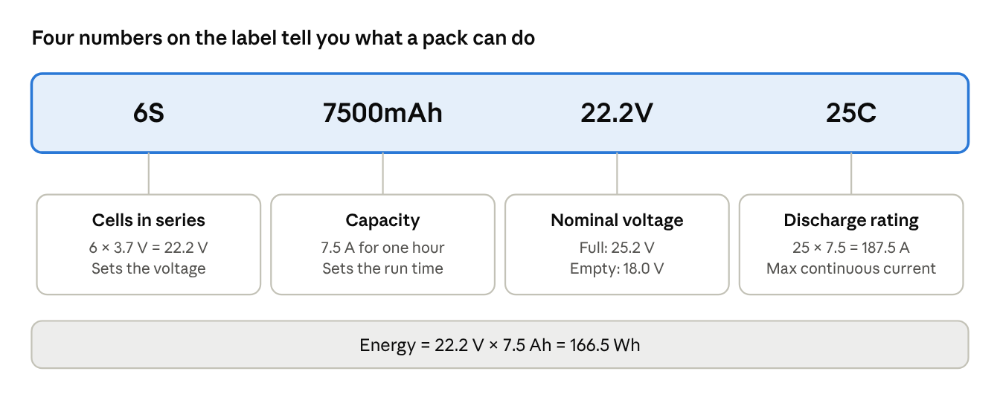
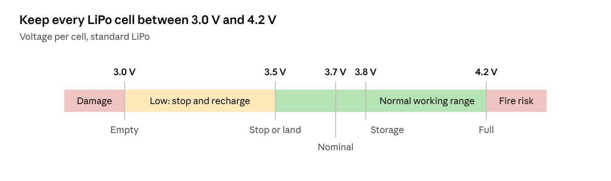
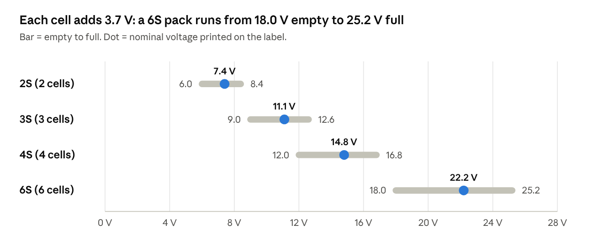
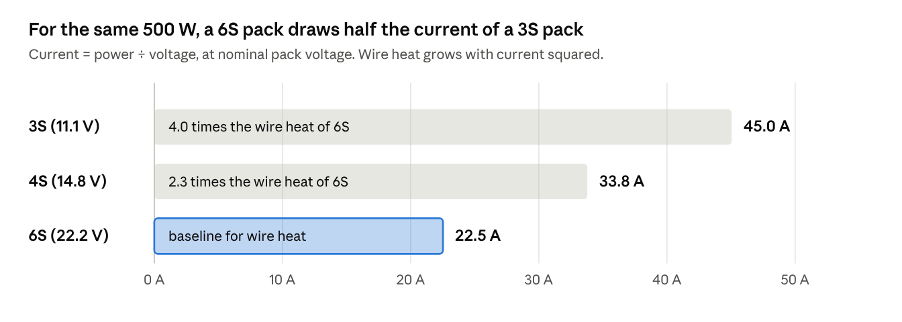
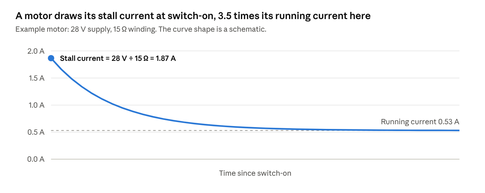
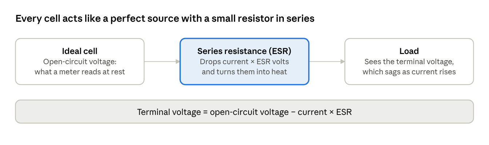
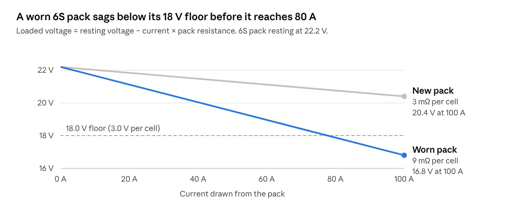

# Battery Fundamentals

Nov 12, 2026 · Bardia Mojra · CSE Senior Design Lab, UTA

How batteries work and how to choose one: cells and labels, what 3S, 4S and 6S mean, run time, peak current and ESR. Part of the lab's battery cheat sheets, with Charger Guides, Battery Guides and Connector Cheat Sheet.

## Safety

Lithium batteries store a lot of energy, and mishandling them causes fires. Read this page before you touch the charging table.

**In an emergency (smoke, hissing, swelling, heat):**

1. Unplug the charger's power cord from the wall.
2. If you can do it safely, move the battery to the floor, away from people and equipment. Do not carry a burning or venting pack.
3. Get everyone back and call for help. Notify Steve (lab manager) or a TA right away.

**Every time you charge:**

- Never leave a charging battery unattended.
- Set the charger to the battery's chemistry and cell count before you press start. A wrong setting is the most common cause of fires.
- Always plug in the balance lead as well as the main lead.
- Do not charge a pack that is puffy, dented, punctured, hot, or has damaged wires. Hand it to Steve or a TA.
- Do not charge above 1C unless the battery label says you may.
- Never let the main connector's two contacts touch each other or anything metal.
- If you are in doubt about anything, stop and ask Steve or a TA.

## Battery basics

A battery pack is a stack of cells. The chemistry sets the volts per cell, and the label tells you the rest.

- **Cell:** one electrochemical unit. A LiPo cell is 3.7 V nominal.
- **Series (S):** cells wired end to end. Voltages add, capacity stays the same.
- **Parallel (P):** cells wired side by side. Capacity adds, voltage stays the same.

### How to read a battery label

example label · arithmetic from the label values

Energy in watt-hours (Wh) is the fair way to compare packs of different voltage. Capacity in mAh alone is not, because a 6S 5000 mAh pack holds twice the energy of a 3S 5000 mAh pack. To count cells on an unlabelled pack, count the balance-lead pins and subtract one ([Oscar Liang](https://oscarliang.com/lipo-battery-guide)). Treat the C rating as optimistic, since vendors often inflate it.

### Common chemistries

| Chemistry                     | Nominal V per cell | Full-charge V per cell | Where you will see it           |
|-------------------------------|--------------------|------------------------|---------------------------------|
| LiPo (lithium polymer)        | 3.7                | 4.20                   | Most UAV and UGV packs          |
| Li-ion (cylindrical cells)    | 3.6                | 4.20                   | Tool packs, 18650 packs         |
| LiFe (lithium iron phosphate) | 3.2 to 3.3         | 3.65                   | Receiver packs, long-life packs |

NiMH cells are 1.2 V nominal and lead-acid cells are 2.0 V. Each chemistry needs its own charger program, and a charger set for the wrong one will overcharge the pack. Sources: [Battery University BU-409](https://batteryuniversity.com/article/bu-409-charging-lithium-ion), [Tenergy TB6B manual](https://cdn.robotshop.com/media/t/ten/rb-ten-48/pdf/tenergy-tb6b-multi-balance-charger-nimh-nicdlipoli-fe--power-supply-manual.pdf).

### LiPo voltage limits

per-cell LiPo limits · Oscar Liang LiPo guide

Stop driving or land when cells sag to about 3.5 to 3.6 V under load. Do not run a pack down to 3.0 V on purpose. Store packs at 3.80 to 3.85 V per cell, not full and not empty. LiHV packs charge to 4.35 V per cell, but only if the label says LiHV ([Oscar Liang](https://oscarliang.com/lipo-battery-guide)).

### Capacity is not capacitance

Capacity (mAh or Ah) is how much charge a battery delivers: 7500 mAh means 7.5 A for one hour. Capacitance (farads) is a property of capacitors and does not appear on battery labels. If you see mAh, Ah or Wh, you are reading capacity or energy.

## What 3S, 4S and 6S mean

The number in front of the S is how many cells are wired in series. More cells means more volts, and more volts means fewer amps for the same power.

cells × 3.0 / 3.7 / 4.2 V per cell · Oscar Liang LiPo guide

A pack's voltage is not one number. It falls from full to empty as you use it, so everything connected to it must tolerate the full voltage and still work near the empty voltage.

### The voltage versus amps tradeoff

Power is volts times amps. A motor system that needs 500 W can get it from high voltage and low current, or low voltage and high current.

computed: 500 W ÷ nominal pack voltage

**Why go higher in voltage (6S):**

- Half the current means thinner wire, smaller connectors and cooler speed controllers.
- Less voltage sag under load, so heavy vehicles keep their punch.
- It suits large UAVs and heavy UGVs that draw hundreds of watts.

**Why stay lower (3S or 4S):**

- Every part must be rated for the pack's full voltage: speed controllers, motors, power modules and regulators. One under-rated part will burn.
- Small vehicles and bench electronics do not draw enough current to need it.
- More cells means more to balance and more energy released if something goes wrong.

**Rule:** pick the cell count your speed controller and motors are rated for, and never exceed the lowest-rated part on the power bus. Boards that need 5 V or 12 V always get a regulator (BEC or buck converter), never a direct pack connection.

## Choosing the right battery

Choose a pack in three checks: voltage the system is rated for, enough energy for the run time, and enough current for the peaks.

### 1. Run time

Plan to use about 80% of a pack. That rule of thumb keeps cells near the 3.5 V stop point instead of draining them flat.

**Run time (hours) = 0.8 × energy (Wh) ÷ average power (W)**

**Energy (Wh) = nominal voltage (V) × capacity (Ah)**

If you know average current instead of power, use 0.8 × capacity (Ah) ÷ average current (A). Measure the average draw with a power meter or the flight controller log. Do not guess it.

### 2. Peak current

The pack must supply the largest current the vehicle ever draws. Maximum continuous current is capacity (Ah) × C rating, so a 7500 mAh 25C pack is rated for 7.5 × 25 = 187.5 A ([Oscar Liang](https://oscarliang.com/lipo-battery-guide)). C ratings are often inflated, so leave a wide margin. The connector and wire must carry that current too (see the Connector Cheat Sheet).

### 3. Weight and use

- **UAV:** weight is the main cost. A heavier pack raises hover power, so doubling capacity gives less than double the flight time. Peak current is high, so C rating matters.
- **UGV:** weight matters less. Size the pack by watt-hours and check stall current of the drive motors.
- **Low-voltage electronics (5 V and 12 V boards):** current is small, so almost any pack works through a regulator. Add a low-voltage alarm or cutoff, because a bare LiPo has no protection against over-discharge.

### Peak demand: motor inrush versus battery supply

A motor's largest current comes at the instant it starts or stalls, not while it runs. A stopped motor makes no back-EMF, so only the winding resistance limits the current: stall current is supply voltage divided by winding resistance ([Industrial Monitor Direct](https://industrialmonitordirect.com/blogs/knowledgebase/understanding-dc-motor-stall-current-vs-nameplate-power)).

stall = supply voltage ÷ winding resistance · example motor from Industrial Monitor Direct · decay shape schematic

The spike lasts only while the motor gains speed. A jammed wheel or blocked propeller holds the motor at stall current, which overheats the windings within seconds to minutes. Startup current can reach 10 to 20 times the running current on some motors ([Control.com](https://control.com/technical-articles/inrush-current-why-is-motor-startup-current-so-high/)).

**Check the battery against the peak, not the average:**

1. Find the stall current of each motor from its datasheet, or divide the supply voltage by the winding resistance.
2. Add up the motors that can start or stall at the same moment. That sum is the peak demand.
3. Compare the peak with the pack's continuous rating (capacity in Ah × C rating) and with the connector's continuous rating. Both must be higher.
4. Work out the voltage sag at the peak using the pack's ESR (next subsection). The sagged voltage must stay above the pack's floor and above the minimum input of every regulator and computer on the bus.

If step 4 fails, the vehicle browns out: the motors start, the bus voltage dips, and the flight controller or computer resets. Fix it with a pack of lower resistance or higher capacity, a higher cell count, or a softer throttle ramp in the speed controller.

### Cell ESR (equivalent series resistance)

ESR is the small resistance inside every cell. Hobby chargers call it internal resistance (IR). It is the reason a pack's voltage drops when you draw current.

cell equivalent circuit · 3 parts

ESR costs you in three ways:

- **Voltage sag:** the drop equals current × resistance. Cell resistances add up in a series pack, so a 6S pack at 3 mΩ per cell is 18 mΩ and loses 1.8 V at 100 A ([RC Helicopter Fun](https://www.rchelicopterfun.com/lipo-internal-resistance.html)).
- **Heat:** the pack wastes current² × resistance inside itself. At 50 A, an 18 mΩ pack makes 45 W of heat and a 54 mΩ pack makes 135 W.
- **Lower real current limit:** a high-ESR pack cannot deliver its label C rating, whatever the label says.

computed: 22.2 V − current × 6 cells × per-cell resistance · 3 mΩ new, 9 mΩ worn

**Typical values and what changes them:**

- New large packs (around 5000 mAh) read about 1 to 4 mΩ per cell at room temperature. Small cells read much higher, so compare only packs of similar capacity ([RC Helicopter Fun](https://www.rchelicopterfun.com/lipo-internal-resistance.html)).
- ESR rises with age and use. The same source reports a 7-year-old 6S pack at about three times its original value.
- Cold raises ESR sharply: about 3 to 4 times higher at 5 °C than at 35 °C ([UAVModel](https://blog.uavmodel.com/5995-2/)).
- Connectors, solder joints and long leads add resistance in series with the pack. If sag is large but the cells read low, look there.

**How to measure and use it:**

1. Use a charger with a per-cell IR function. Measure at room temperature, at storage charge, after the pack has rested for an hour.
2. Write the new-pack reading on the pack as its baseline. Always use the same charger, because readings differ between chargers.
3. Recheck every few months. Retire or downgrade a pack whose reading has climbed well above its baseline, whose cells no longer match each other, or that runs hotter than it used to on the same job.

Without an IR function, measure it directly: note the pack voltage at a small load and at a large load, then divide the voltage difference by the current difference.

### Worked example: 6S 16000 mAh versus 6S 7500 mAh

|                                          | 6S 16000 mAh  | 6S 7500 mAh   |
|------------------------------------------|---------------|---------------|
| Energy (22.2 V × Ah)                     | 355.2 Wh      | 166.5 Wh      |
| Usable energy at 80%                     | 284 Wh        | 133 Wh        |
| Run time at 300 W average                | 57 min        | 27 min        |
| 1C charge current                        | 16 A          | 7.5 A         |
| Charger power needed for 1C              | 403 W         | 189 W         |
| Charge time on the 50 W TB6B (about 2 A) | about 8 hours | about 4 hours |

The run times assume the same 300 W draw for both packs. On a UAV the larger pack also adds weight, which raises the draw: a [Tattu 6S 16000 mAh 30C](https://grepow.com/uav-battery/6s-16000mah-22-2v-30c-lipo-drone-battery.html) weighs 1974 g. The charge rows show a practical problem: the bench charger cannot charge either pack at 1C.

## Sources

Every number in this document comes from one of these pages or is arithmetic on them.

- [Oscar Liang, LiPo battery guide](https://oscarliang.com/lipo-battery-guide): per-cell voltages, storage voltage, C rating, stop voltage.
- [Battery University BU-409, Charging Lithium-ion](https://batteryuniversity.com/article/bu-409-charging-lithium-ion): Li-ion and LiFe charge voltages.
- [Tenergy TB6B product manual (PDF)](https://cdn.robotshop.com/media/t/ten/rb-ten-48/pdf/tenergy-tb6b-multi-balance-charger-nimh-nicdlipoli-fe--power-supply-manual.pdf): nominal cell voltages by chemistry, 50 W charge limit.
- [Grepow, Tattu 6S 16000 mAh 30C](https://grepow.com/uav-battery/6s-16000mah-22-2v-30c-lipo-drone-battery.html): pack weight.
- [Industrial Monitor Direct, DC motor stall current](https://industrialmonitordirect.com/blogs/knowledgebase/understanding-dc-motor-stall-current-vs-nameplate-power): stall current formula and the 28 V, 15 Ω example motor.
- [Control.com, Why is motor startup current so high?](https://control.com/technical-articles/inrush-current-why-is-motor-startup-current-so-high/): back-EMF explanation and the 10 to 20 times figure.
- [RC Helicopter Fun, LiPo internal resistance](https://www.rchelicopterfun.com/lipo-internal-resistance.html): typical per-cell values, measuring method, the 1.8 V at 100 A example.
- [UAVModel, LiPo voltage sag under load](https://blog.uavmodel.com/5995-2/): sag formula, temperature effect, resistance in the power path.

Not from a source: the 80% usable-capacity rule and the 300 W and 500 W loads are illustrative. The inrush curve shape and the new and worn pack resistances are illustrative.
