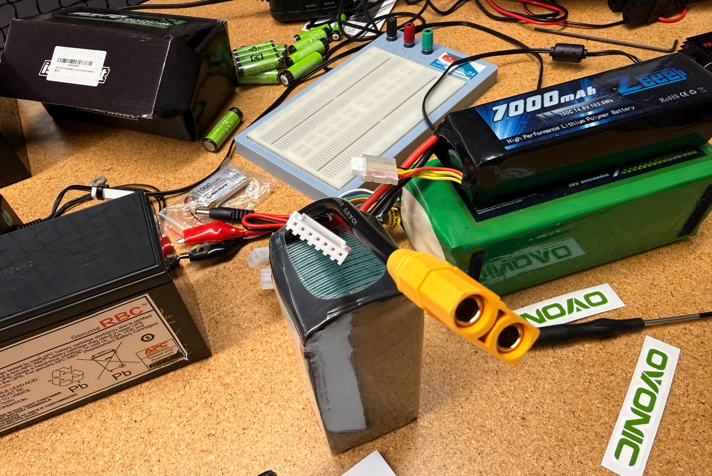
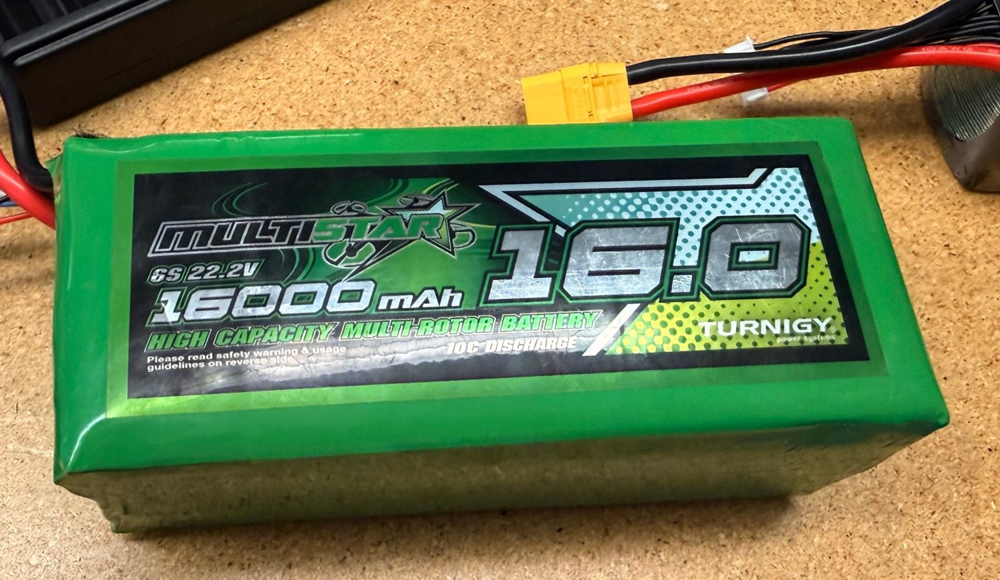
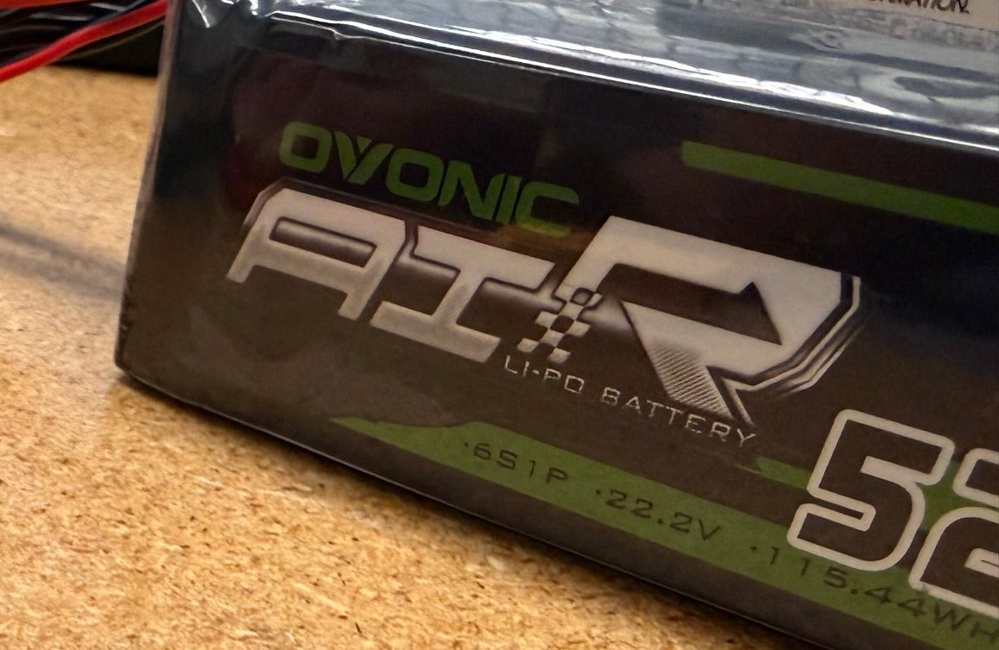
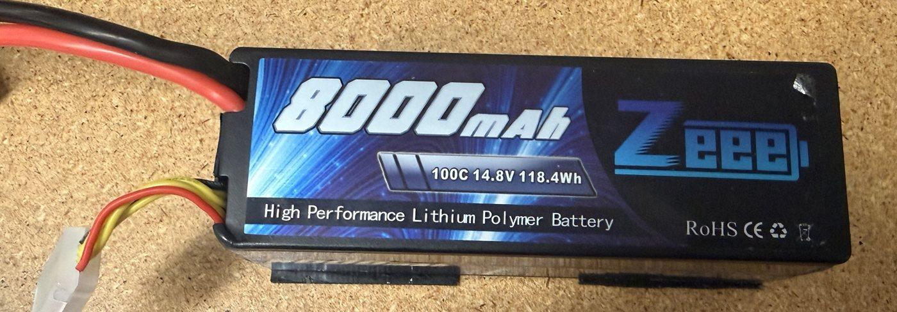
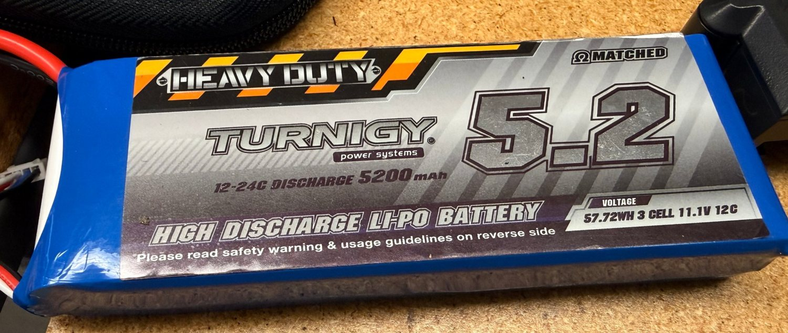
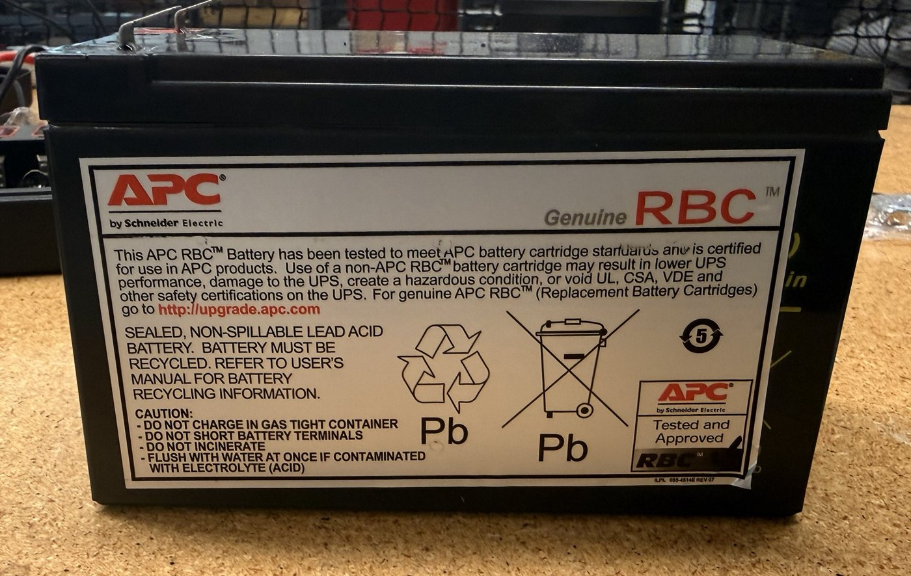

# Battery Guides

Nov 12, 2026 · Bardia Mojra · CSE Senior Design Lab, UTA

The packs in the lab: the numbers to know, how to charge each one, and how to use it. Part of the lab's battery cheat sheets, with Battery Fundamentals, Charger Guides and Connector Cheat Sheet.

## Safety

**In an emergency (smoke, hissing, swelling, heat):**

1. Unplug the charger's power cord from the wall.
2. If you can do it safely, move the battery to the floor, away from people and equipment. Do not carry a burning or venting pack.
3. Get everyone back and call for help. Notify Steve (lab manager) or a TA right away.

Never charge or use a pack that is puffy, dented, punctured, hot, or has damaged wires. Hand it to Steve or a TA.

## Packs in the lab

| Pack                       | Cells      | Capacity  | Energy    | C rating on label        | 1C charge current | Charger            |
|----------------------------|------------|-----------|-----------|--------------------------|-------------------|--------------------|
| Turnigy Multistar 6S 16000 | 6S, 22.2 V | 16000 mAh | 355.2 Wh  | 10C                      | 16 A              | ISDT 608PD         |
| Ovonic Air 6S 5200         | 6S, 22.2 V | 5200 mAh  | 115.44 Wh | not visible in the photo | 5.2 A             | ISDT 608PD         |
| Zeee 4S 8000               | 4S, 14.8 V | 8000 mAh  | 118.4 Wh  | 100C                     | 8 A               | TB6B or ISDT 608PD |
| Zeee 4S 7000               | 4S, 14.8 V | 7000 mAh  | 103.6 Wh  | 100C                     | 7 A               | TB6B or ISDT 608PD |
| Turnigy Heavy Duty 3S 5200 | 3S, 11.1 V | 5200 mAh  | 57.72 Wh  | 12C (24C burst)          | 5.2 A             | TB6B or ISDT 608PD |

Values are read from the pack labels in the lab photos. The Ovonic capacity is worked out from its label energy: 115.44 Wh ÷ 22.2 V = 5.2 Ah.

## Quick reference for every LiPo pack

| Pack | Full   | Storage | Stop under load | Never below |
|------|--------|---------|-----------------|-------------|
| 3S   | 12.6 V | 11.4 V  | 10.5 V          | 9.0 V       |
| 4S   | 16.8 V | 15.2 V  | 14.0 V          | 12.0 V      |
| 6S   | 25.2 V | 22.8 V  | 21.0 V          | 18.0 V      |

These are the cell count times 4.2, 3.8, 3.5 and 3.0 V per cell.

## How to use any pack

1. **Before use:** look for swelling, dents, torn wrap and damaged leads. Check that the pack is charged and that the cells match each other.
2. **Connect:** match the connector type and the polarity. Never force a plug, and never use the balance lead to power anything.
3. **During use:** set the low-voltage alarm or cutoff to the stop voltage in the table. Stop when it triggers.
4. **After use:** let the pack cool to room temperature before charging.
5. **Storage:** if the pack will sit for more than a few days, bring it to storage voltage.
6. **Report:** tell Steve or a TA about any pack that swelled, got hot, was dropped, or was run below its stop voltage.

## Pack cards

### Turnigy Multistar 6S 16000 mAh

These are the older packs from UTARI that are being phased out. Check with Steve before you use one.

|                             | Value                          |
|-----------------------------|--------------------------------|
| Nominal voltage             | 22.2 V                         |
| Energy                      | 355.2 Wh                       |
| Label rating                | 10C, which is 160 A continuous |
| Connector                   | XT90                           |
| Charge current at 1C        | 16 A                           |
| Charger power needed for 1C | 403 W                          |

- Charge on the ISDT 608PD: LiPo, 6S. With a 140 W USB-C adapter it gets about 5.6 A, which takes about 3 hours. Do not start a charge you cannot stay with.
- Alarm at 21.0 V, store at 22.8 V, never below 18.0 V.
- It holds far more energy than the other packs, so a failure is more severe. Handle and store it with extra care.
- These packs are old, so their ESR is likely to have risen. Measure it before trusting one on a high-current vehicle.

### Ovonic Air 6S 5200 mAh

- Charge on the ISDT 608PD: LiPo, 6S, 5.2 A or less. A 1C charge needs 131 W, so it needs a 140 W USB-C adapter. With a 65 W adapter, set 2.6 A and allow about 2 hours.
- Alarm at 21.0 V, store at 22.8 V, never below 18.0 V.
- The pack in the photo has an XT90 connector.

### Zeee 4S 7000 mAh and 8000 mAh

- Charge with the LiPo balance program, 4S, 14.8 V. On the TB6B the 50 W limit allows 3.0 A, which takes about 2.5 hours. On the ISDT 608PD, set 1C or less: 7 A or 8 A.
- Alarm at 14.0 V, store at 15.2 V, never below 12.0 V.
- The label says 100C, which would be 700 A or more. No connector or wire on these packs can carry that. Treat it as marketing and size the system from the connector rating and a measured ESR.

### Turnigy Heavy Duty 3S 5200 mAh

- Charge with the LiPo balance program, 3S, 11.1 V. On the TB6B the 50 W limit allows 4.0 A, which takes about 1.5 hours.
- Alarm at 10.5 V, store at 11.4 V, never below 9.0 V.
- The label rates it at 12C continuous, which is 62 A. This is a low-rate pack, so check the peak demand of the vehicle before using it for drive motors.

### 6S 7500 mAh (planned replacement)

This is the pack that is to replace the 6S 16000 mAh packs. There is no photo of one yet, so brand, C rating, connector and weight are pending.

- Energy 166.5 Wh. Charge current at 1C is 7.5 A, which needs 189 W.
- Charge on the ISDT 608PD: LiPo, 6S, 7.5 A or less, limited by the USB-C adapter.
- Alarm at 21.0 V, store at 22.8 V, never below 18.0 V.

### Not LiPo: do not use a LiPo program

- **APC RBC sealed lead-acid battery:** a UPS replacement cartridge. Charge it only with the NOCO Genius 2. Read its voltage from the battery's own markings first, because the label face in the photo does not show it.
- **Amazon Basics NiMH cells (1.2 V):** rechargeable AA and AAA cells. Charge them in a NiMH cell charger.

## Sources

- Lab photos taken at the charging table: pack labels.
- [Oscar Liang, LiPo battery guide](https://oscarliang.com/lipo-battery-guide): per-cell voltages behind the quick-reference table.
- [Oscar Liang, ISDT 608PD review](https://oscarliang.com/isdt-608pd-charger/): the 140 W USB-C limit used for charge times.
- [Tenergy TB6B product manual (PDF)](https://cdn.robotshop.com/media/t/ten/rb-ten-48/pdf/tenergy-tb6b-multi-balance-charger-nimh-nicdlipoli-fe--power-supply-manual.pdf): the 50 W limit used for charge times.
