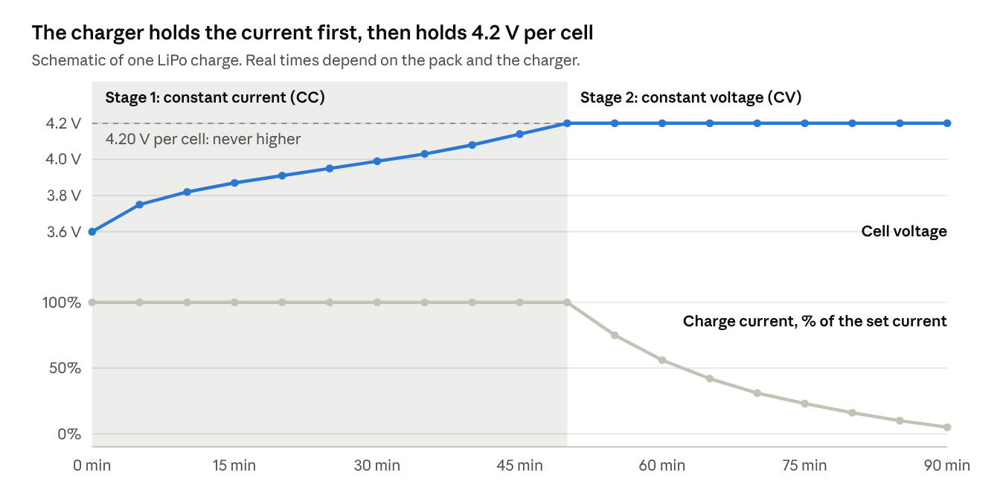
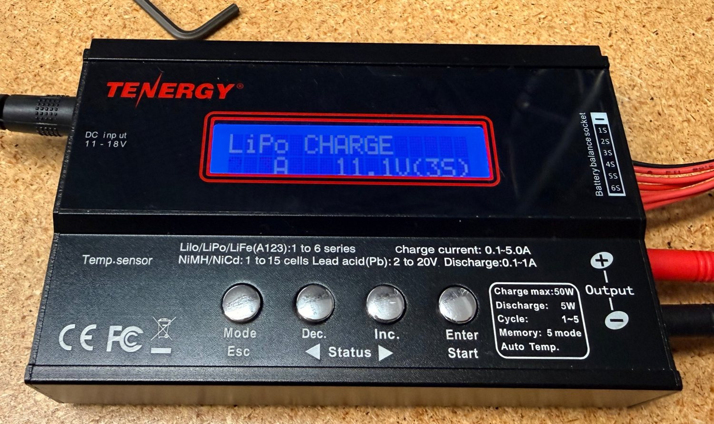
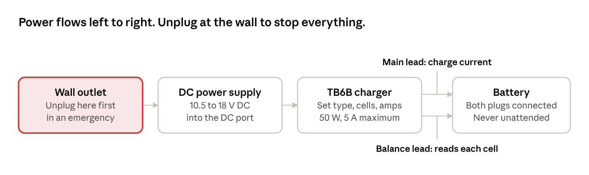
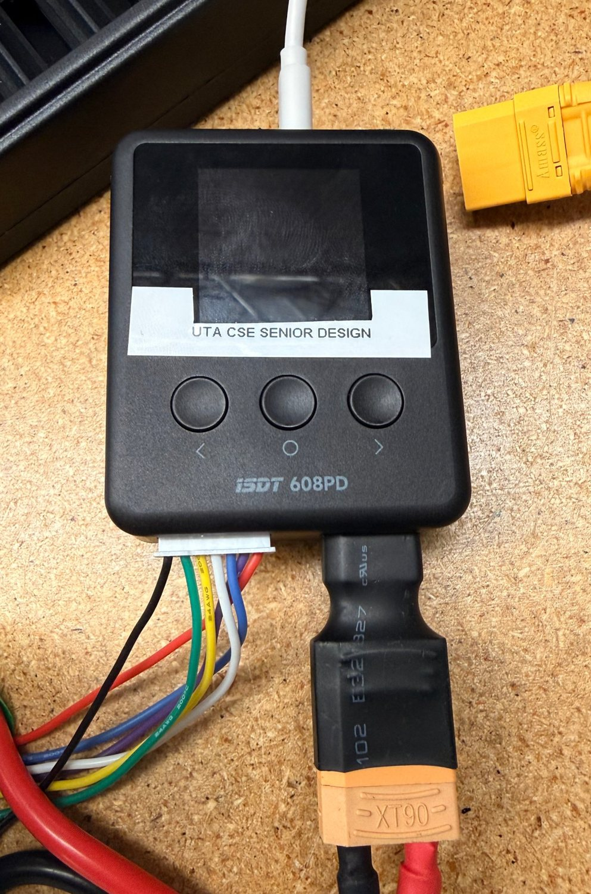
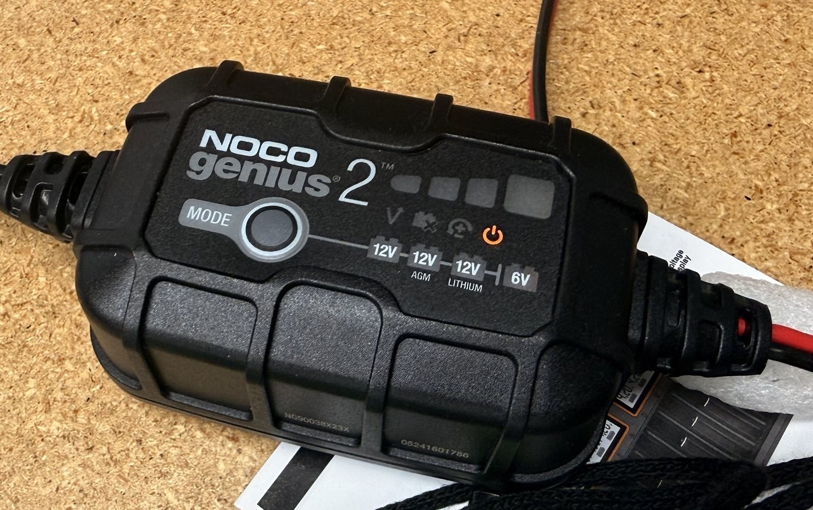

# Charger Guides

Nov 12, 2026 · Bardia Mojra · CSE Senior Design Lab, UTA

How lithium chargers work, and step-by-step guides for the three chargers on the charging table: Tenergy TB6B, ISDT 608PD and NOCO Genius 2. Part of the lab's battery cheat sheets, with Battery Fundamentals, Battery Guides and Connector Cheat Sheet.

## Safety

**In an emergency (smoke, hissing, swelling, heat):**

1. Unplug the charger's power cord from the wall.
2. If you can do it safely, move the battery to the floor, away from people and equipment. Do not carry a burning or venting pack.
3. Get everyone back and call for help. Notify Steve (lab manager) or a TA right away.

**Every time you charge:**

- Never leave a charging battery unattended.
- Set the charger to the battery's chemistry and cell count before you press start. A wrong setting is the most common cause of fires.
- Always plug in the balance lead as well as the main lead.
- Do not charge a pack that is puffy, dented, punctured, hot, or has damaged wires. Hand it to Steve or a TA.
- Do not charge above 1C unless the battery label says you may.
- If you are in doubt about anything, stop and ask Steve or a TA.

## Charger basics

A lithium charger limits the current first and the voltage second. Your job is to give it three correct settings.

### Three settings to get right

1. **Chemistry.** Pick LiPo, Li-ion or LiFe to match the label. Each program stops at a different voltage, so the wrong one overcharges the pack.
2. **Cell count.** Match the S number on the label. Confirm that the charger detects the same count before you start.
3. **Current.** Charge at 1C or less: the capacity in Ah is the current in A. A 5000 mAh pack charges at 5 A or less ([Oscar Liang](https://oscarliang.com/lipo-battery-guide)).

### How a charge proceeds

In stage 1 the charger pushes the current you set and the voltage climbs. This stage fills roughly 70 to 85% of the pack. In stage 2 the charger holds 4.20 V per cell and the current tapers on its own. The charge ends when the current falls to a few percent of the capacity rating. Lithium packs get no trickle charge after that ([Battery University BU-409](https://batteryuniversity.com/article/bu-409-charging-lithium-ion)). The plot is a schematic, not a measurement.

### Balance charging

Cells in a pack drift apart with use. The balance lead lets the charger read every cell and bleed down the high ones, so no single cell passes 4.20 V while the pack total still looks fine. Use the balance program for every pack of 2S or more.

### Limits

- **Voltage:** never above 4.20 V per cell for standard LiPo. Prolonged charging above 4.30 V plates lithium inside the cell and can end in venting with flame ([BU-409](https://batteryuniversity.com/article/bu-409-charging-lithium-ion)).
- **Temperature:** do not charge lithium packs below freezing ([BU-107](https://batteryuniversity.com/article/bu-107-comparison-table-of-secondary-batteries)). Let a warm pack cool to room temperature first. A pack may warm by about 5 °C while charging. Stop if it rises more than 10 °C.
- **Charger power:** a charger's watt limit caps the current. Maximum current is charger watts divided by the full pack voltage.
- **Storage:** if a pack will sit for more than a few days, run the storage program to bring it to about 3.8 V per cell.

## Tenergy TB6B

The TB6B is a 50 W balance charger for 1 to 6 lithium cells, with a charge current of 0.1 to 5.0 A ([manual](https://cdn.robotshop.com/media/t/ten/rb-ten-48/pdf/tenergy-tb6b-multi-balance-charger-nimh-nicdlipoli-fe--power-supply-manual.pdf)).

**Do not charge 6S packs on the TB6B that is on the table now.** Its balance board has failed for 6S. Use the ISDT 608PD for 6S packs.

### How to: balance charge a LiPo

1. Inspect the pack. If it is puffy, damaged or warm, stop and hand it to Steve or a TA.
2. Plug the DC supply into the wall and into the charger. The screen shows the charger name for about 2 seconds.
3. Plug the balance board into the balance port and the output lead into the banana sockets, red to red and black to black.
4. Connect the battery's main plug to the output lead. Then plug its balance lead into the balance-board slot that matches the cell count.
5. Press **Mode/Esc** until the screen shows the LiPo program, then press **Enter/Start**.
6. Use **Dec.** and **Inc.** to select **BALANCE**.
7. Press **Enter/Start** so the current blinks, and set it with **Dec.** and **Inc.** Press **Enter/Start** again and set the voltage and cell count to match the label: 11.1 V for 3S, 14.8 V for 4S, 22.2 V for 6S.
8. Hold **Enter/Start** for 2 seconds. The screen shows **R** (cells the charger detects) and **S** (cells you selected). If they match, press **Enter/Start** to start. If they differ, press **Mode/Esc** and recheck the pack and settings.
9. Stay with the charger. Use **Dec.** and **Inc.** to view each cell's voltage while it charges.
10. When the charge finishes, press **Mode/Esc**, unplug the battery, then unplug the charger.

**Which current to set.** Use the smaller of 1C and the charger's power limit for that pack:

| Pack | Full voltage | Most the 50 W limit allows |
|------|--------------|----------------------------|
| 3S   | 12.6 V       | 4.0 A                      |
| 4S   | 16.8 V       | 3.0 A                      |
| 6S   | 25.2 V       | 2.0 A                      |

### Other lithium programs

- **CHARGE:** charges without balancing. Do not use it for packs with a balance lead.
- **FAST CHG:** shorter charge with slightly less capacity.
- **STORAGE:** brings the pack to storage level for long-term storage.
- **DISCHARGE:** discharges at up to 1.0 A (5 W limit).

### Error messages

| Screen message                | Meaning                             | What to do                                                    |
|-------------------------------|-------------------------------------|---------------------------------------------------------------|
| REVERSE POLARITY              | Battery connected backwards         | Unplug at once and check red and black                        |
| CONNECTION BREAK              | Lead disconnected during the charge | Reseat the main lead and restart                              |
| SHORT ERR                     | Short circuit on the output         | Unplug and inspect the leads                                  |
| INPUT VOL ERR                 | Supply voltage too low              | Check the DC supply                                           |
| VOL SELECT ERR                | Wrong pack voltage selected         | Recheck the cell count                                        |
| BATTERY CHECK LOW VOLTAGE     | Pack voltage below the setting      | Recheck the cell count. An over-discharged pack goes to Steve |
| BATTERY CHECK HIGH VOLTAGE    | Pack voltage above the setting      | Recheck the cell count and chemistry                          |
| CELL LOW VOL or CELL HIGH VOL | One cell is out of range            | Stop. Give the pack to Steve or a TA                          |
| CELL CONNECT                  | Bad balance connection              | Reseat the balance lead                                       |
| TEMP OVER ERR                 | Charger is too hot                  | Let it cool before restarting                                 |
| BREAK DOWN or CONTROL FAILURE | Charger fault                       | Stop using the charger and tell Steve                         |

### How to: storage charge

1. Connect the pack exactly as for a balance charge, with both the main lead and the balance lead.
2. Select the LiPo program, then use **Dec.** and **Inc.** to select **STORAGE**.
3. Set the current and the cell count to match the label, as in a balance charge.
4. Hold **Enter/Start** for 2 seconds, confirm that R and S match, and press **Enter/Start** to start.
5. The charger charges or discharges the pack to storage level and then stops. Discharging is slow, because the TB6B discharges at 1.0 A at most.

### How to: check a pack before you charge it

1. Connect the main lead and the balance lead, and start a balance charge.
2. Use **Dec.** and **Inc.** to show the individual cell voltages.
3. If any cell reads below 3.0 V, or one cell is far from the others, stop and give the pack to Steve or a TA.

### TB6B guidance

- Use it for 2S to 4S packs. Its 50 W limit makes it slow on 6S and on large packs.
- The manual lists no internal-resistance function, so use the ISDT 608PD for ESR checks.
- The safety timer defaults to 120 minutes. A large pack at low current can hit that limit before it is full. Ask Steve before changing charger settings.
- The unit's own label gives the DC input as 11 to 18 V.

## ISDT 608PD (the USB-C charger)

The ISDT 608PD is a pocket charger for 1 to 6 lithium cells (LiPo, LiHV, LiFe) with a charge current of 0.5 to 10 A. It delivers up to 140 W from a USB-C supply and up to 240 W from a DC supply on its XT60 input ([Oscar Liang review](https://oscarliang.com/isdt-608pd-charger/)). It is the charger to use for 6S packs.

The lab's unit is labelled UTA CSE SENIOR DESIGN. It is powered through its USB-C port, and its XT60 output carries an XT60-to-XT90 adapter for the 6S packs.

**The USB-C power adapter sets the speed.** The charger cannot deliver more power than the adapter supplies. Read the wattage printed on the adapter, then divide by the full pack voltage:

| USB-C adapter | Most current into 6S (25.2 V) | Most current into 4S (16.8 V) | Most current into 3S (12.6 V) |
|---------------|-------------------------------|-------------------------------|-------------------------------|
| 65 W          | 2.6 A                         | 3.9 A                         | 5.2 A                         |
| 100 W         | 4.0 A                         | 6.0 A                         | 7.9 A                         |
| 140 W         | 5.6 A                         | 8.3 A                         | 10 A (charger limit)          |

These figures ignore conversion losses, so expect slightly less.

**Buttons:** left, centre and right, under the screen.

### How to: balance charge a LiPo

1. Inspect the pack. If it is puffy, damaged or warm, stop and hand it to Steve or a TA.
2. Power the charger from the USB-C adapter and wait for the screen.
3. Connect the pack's main plug to the charger's output (through the XT90 adapter for 6S packs). Then plug the balance lead into the balance port.
4. Press **centre** to open the profile list. Use **left** and **right** to pick a profile.
5. To change a setting, hold **centre** to enter edit mode. Use **left** and **right** to change the value, and press **centre** to move to the next setting. Hold **centre** again to leave edit mode.
6. Check that the chemistry, the cell count and the current match the pack label. Set the current to 1C or less, and no more than the table above allows.
7. Press **centre** to start. Stay with the charger.
8. While it charges, use **left** and **right** to view each cell's voltage and internal resistance.
9. To stop early, double-press **centre**. When the charge finishes, unplug the pack, then the charger.

### How to: check cell voltages

Plug in only the balance lead. The screen shows each cell's voltage. Use this to check a pack before charging or before use.

### How to: read ESR

Start a balance charge, then use **left** and **right** to reach the internal-resistance screen. Record the per-cell values as described in Battery Fundamentals.

### ISDT 608PD guidance

- It has no storage or discharge program. Use the TB6B storage program for 2S to 4S packs. For 6S packs, ask Steve how the lab brings them to storage voltage.
- The charger stores five profiles. Check the profile every time, because the last user may have changed it.
- Keep the XT90 adapter on the charger so nobody builds an adapter chain.
- These steps come from a published review of the charger, not from a test on the lab's unit. Walk through them once at the table and correct anything that differs.
- Error messages: to be added from the charger's printed manual.

## NOCO Genius 2 (lead-acid charger)

The NOCO Genius 2 is a 2 A automatic charger for 6 V and 12 V lead-acid batteries and 12 V lithium batteries that have a built-in BMS ([datasheet](https://cdn.tayna.com/datasheets/NOCO%20Genius%202%20Charger%20Data%20Sheet.pdf)). Use it for the APC lead-acid battery. Never use it on LiPo packs: they have no BMS and it cannot balance them.

1. Connect red to positive and black to negative, then plug the charger into the wall.
2. Press **MODE** until the LED matches the battery: **12V** for standard lead-acid, **12V AGM**, **12V LITHIUM**, or **6V**.
3. The charger runs on its own and stops when the battery is full.

## Sources

- [Oscar Liang, LiPo battery guide](https://oscarliang.com/lipo-battery-guide): 1C charge rule.
- [Battery University BU-409, Charging Lithium-ion](https://batteryuniversity.com/article/bu-409-charging-lithium-ion): charge stages, 4.20 V limit, overcharge effects, temperature rise.
- [Battery University BU-107, Comparison Table of Secondary Batteries](https://batteryuniversity.com/article/bu-107-comparison-table-of-secondary-batteries): no charging below freezing.
- [Tenergy TB6B product manual (PDF)](https://cdn.robotshop.com/media/t/ten/rb-ten-48/pdf/tenergy-tb6b-multi-balance-charger-nimh-nicdlipoli-fe--power-supply-manual.pdf): specifications, button steps, error messages.
- [Oscar Liang, ISDT 608PD review](https://oscarliang.com/isdt-608pd-charger/): specifications, buttons and charging steps.
- [NOCO Genius 2 datasheet (PDF)](https://cdn.tayna.com/datasheets/NOCO%20Genius%202%20Charger%20Data%20Sheet.pdf): charge current, modes and supported batteries.
- Lab photos taken at the charging table.
