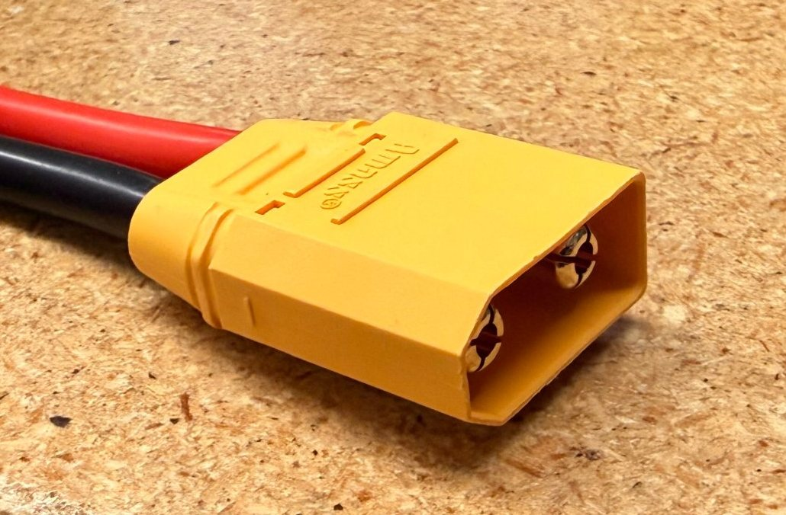
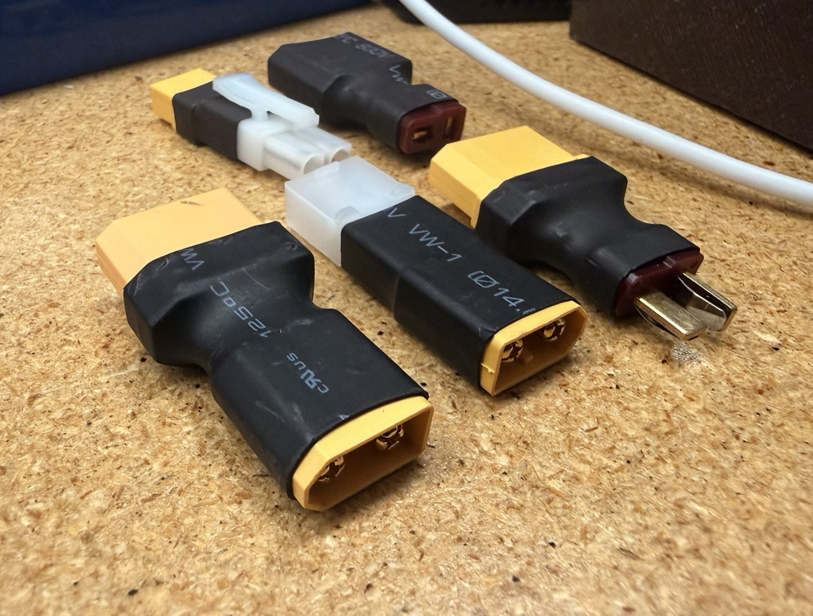

# Connector Cheat Sheet

Nov 12, 2026 · Bardia Mojra · CSE Senior Design Lab, UTA

Pick a connector by the continuous current it must carry, then match the wire gauge to it. Part of the lab's battery cheat sheets, with Battery Fundamentals, Charger Guides and Battery Guides.

## Safety

- Never let a pack's two main contacts touch each other or anything metal. A shorted LiPo can start a fire in seconds.
- Check polarity before you plug anything in, and never force a plug.
- If a pack or connector smokes, sparks or gets hot, unplug it if you can do so safely, move away, and notify Steve (lab manager) or a TA.

## Ratings

Published ratings disagree: hobby vendors usually quote the peak figure as the rating. Size for continuous draw with the lower number.

| Connector                             | Current rating                                       | Wire gauge (AWG)               | Use and notes                                                           |
|---------------------------------------|------------------------------------------------------|--------------------------------|-------------------------------------------------------------------------|
| XT30                                  | 15 A continuous, 30 A peak                           | 16 to 18                       | Small UAVs and low-power loads                                          |
| XT60                                  | 30 A continuous, 60 A peak                           | 12 to 14                       | General default for mid-size packs                                      |
| XT90                                  | 40 A continuous, 90 A peak                           | 10 to 12                       | Large packs. The lab's 6S packs and the ISDT charger's adapter use XT90 |
| Deans (T-plug)                        | 15 A continuous, 30 A peak. Vendors quote up to 60 A | 12 to 18                       | Older standard. Horizon Hobby advises against it above 3S               |
| EC3                                   | 60 A (vendor figure)                                 | 12 to 14                       | Bullet contacts in a blue housing                                       |
| EC5                                   | 120 A (vendor figure)                                | 10 to 12                       | High-current packs and large vehicles                                   |
| Anderson Powerpole PP15 / PP30 / PP45 | 15 A / 30 A / 45 A (UL rating)                       | 16 to 20 / 12 to 16 / 10 to 14 | Genderless and stackable. One housing takes all three contact sizes     |
| Tamiya                                | Up to 10 A                                           | Not stated in the sources      | Old low-power packs. Not recommended for LiPo                           |
| Molex Mini-Fit Jr.                    | 9 A per circuit at most, 6 A on the largest housings | 16 to 24                       | Board and accessory power, not drive power                              |
| JST-XH                                | 3 A                                                  | 22 to 30                       | Balance leads only. Never power a load from it                          |

Sources: [Digi-Key XT and Deans comparison](https://forum.digikey.com/t/xt30-xt60-xt90-deans-connector-comparison/34551) for the continuous and peak figures, [Ampow wire gauge chart](https://blog.ampow.com/?p=5210) for the vendor figures and wire gauges, [Anderson Powerpole datasheet](https://cdn.shopify.com/s/files/1/0342/1247/9111/files/APP-Singlepole.pdf), [Horizon Hobby connector guide](https://www.horizonhobby.com/blog-what-rc-battery-connectors-should-i-use), [TTI Mini-Fit Jr. page](https://www.tti.com/content/ttiinc/en/manufacturers/molex/products/molex-mini-fit-jr-connectors.html), [Digi-Key JST XH page](https://www.digikey.jp/en/product-highlight/j/jst/xh-series-connectors).

## Working with connectors

- The connector, the wire and the solder joint each limit the current. The weakest one sets the rating.
- Battery side is always the shrouded contact, so a loose pack cannot short on metal.
- Solder XT and Deans connectors while they are plugged into their mate. Heat alone can deform the housing and shift the contacts ([Digi-Key](https://forum.digikey.com/t/xt30-xt60-xt90-deans-connector-comparison/34551)).
- Cover XT30, XT60 and Deans solder joints with heat shrink. Only the XT90 comes with a rear cover.

## In the lab

The XT90 plug is used on the lab's 6S packs. Photos of the other connector types still need to be added.

**Adapter box.** The lab keeps one-piece adapters between XT90, XT60, Deans and Tamiya plugs. An adapter is only as strong as its weaker side, so a Tamiya adapter limits the path to about 10 A. Use one adapter, never two in a row: each adds resistance and a place to plug something in backwards.

