# Batteries and Chargers

**Lab reference for students working with UAV, UGV and benchtop lithium packs.**
Read Section 1 before you touch a battery. Everything after it is reference you can
come back to.

Companion laminate cards (one page each, printed and kept at the charging table):
`cards/00_safety_card.md`, `01_batteries_card.md`, `02_connectors_card.md`,
`03_charging_card.md`. The cards are condensed from this document; **this document is
the authority** when the two disagree.

!!! danger "If something is going wrong right now"
    1. **Unplug the charger from the wall.** Do not try to unplug the battery first.
    2. If you can do it safely, move the pack to the floor, away from people, benches
       and anything that burns. Use the metal bin or sand bucket at the charging table.
    3. **Call Steve (lab manager) or a TA.** Do not leave the pack unattended.
    4. A lithium fire is not a normal fire. Do not use water on the pack. Get people out
       and pull the fire alarm if it is burning.

!!! warning "Lab margin policy - every limit in this document is already derated"
    Published ratings are optimistic, inconsistent between vendors, and measured in
    conditions your vehicle will not match. **This document gives you the conservative
    figure and then takes margin off it.** Work to the derated number, not the vendor's.

    | Thing | Rule |
    |---|---|
    | **Connectors** | **Lab limit = 80% of the lowest published continuous rating** |
    | **Pack discharge** | Plan to **70% of the printed C rating** |
    | **Charge current** | **0.5C is the lab default.** `1C` is the absolute maximum |
    | **Cell floor** | **3.30 V/cell working floor.** 3.00 V is damage, not a target |
    | **Wire** | Go **one gauge thicker** than the connector's minimum |
    | **Temperature** | Stop if a pack is **uncomfortable to hold** (~40 °C) or rises >10 °C |

    Margin is what stops a warm connector becoming a fire. If a calculation says you are
    near a limit, **pick the bigger part**, not the bigger number.

---

## 1. Safety

### 1.1 The five rules

!!! danger "Non-negotiable"
    1. **Never leave a charging battery unattended.** Stay in the room, in sight of it.
    2. **Charge inside the LiPo bag or metal container**, on the charging table, never on
       paper, carpet, foam or a laptop.
    3. **Never charge a pack that is swollen, punctured, wet, or hot.** Quarantine it and
       tell Steve.
    4. **Check the cell count and chemistry on the charger before you press start.** A 3S
       pack charged as 6S is the single most common way a pack catches fire.
    5. **If in doubt, ask Steve or a TA.** No one is annoyed by the question.

### 1.2 Why lithium packs are different

A LiPo pack has no hard case and no internal fuse. The energy is real: a 6S 7500 mAh pack
holds about **167 watt-hours**, which is roughly the energy in 13 grams of TNT, released
as heat rather than blast. Damage, over-charge, over-discharge or a short can start
*thermal runaway*: the cell heats itself faster than it can cool, vents flammable gas and
then burns. It cannot be stopped once it starts; it can only be contained and waited out.

### 1.3 Handling

| Situation | What to do |
|---|---|
| Pack is **swollen or puffed** | Stop using it. Do not charge it. Quarantine in the metal bin, tell Steve, tag it for disposal. |
| Pack is **below 3.3 V per cell** | Do not charge it on the normal setting. Tell a TA; it may be recoverable at low current, or it may be scrap. |
| Pack got **hot in use** (too hot to hold) | Let it cool to room temperature before charging. Log it; a pack that does this repeatedly is dying. |
| Pack was **crashed or crushed** | Quarantine it for at least 30 minutes and watch it before storing. Damage can take minutes to turn into a fire. |
| Pack is **leaking or smells sweet/sharp** | Quarantine immediately, ventilate, tell Steve. Do not inhale the vapor. |
| Pack is **done for good** | Never in the trash. It goes through the lab's hazardous waste route. Ask Steve. |

!!! warning "Storage charge is a safety rule, not a nicety"
    A pack left full (4.20 V per cell) ages fast and is the one most likely to puff on the
    shelf. If a pack will sit for more than about two days, run the charger's **Storage**  
    mode to bring it to roughly **3.80-3.85 V per cell**. See Section 5.4.

---

## 2. Battery Basics

### 2.1 The cell is the unit

Everything starts with one cell. A pack is cells wired together in a box. All the voltage
numbers you will ever use are *per cell*, multiplied by the number of cells in series.

| Chemistry | Nominal | Full charge | Storage | Practical floor | Where you see it |
|---|---|---|---|---|---|
| **LiPo** (lithium polymer) | 3.7 V | **4.20 V** | 3.80-3.85 V | 3.0-3.3 V | UAV, UGV, most lab packs |
| **Li-ion** (18650/21700) | 3.6-3.7 V | 4.20 V | 3.7-3.8 V | 2.5-3.0 V | rovers, power banks, long-endurance packs |
| **LiFePO4** ("LiFe", "A123") | 3.2 V | 3.65 V | ~3.3 V | 2.5 V | receiver packs, tolerant of abuse |
| **NiMH** | 1.2 V | ~1.45 V peak | n/a | 1.0 V | legacy transmitters, older kit |

!!! warning "Verify before you rely on it"
    Those are the figures the hobby and vendor literature agree on, and they match what
    the lab's chargers expect. The **cell datasheet for your specific pack always wins.**  
    If a pack's label says something different, follow the label and tell a TA.

### 2.2 S and P: what "3S", "4S" and "6S" mean

- **S = cells in series.** Series adds *voltage*. Capacity stays the same.
- **P = cells in parallel.** Parallel adds *capacity* (and available current). Voltage
  stays the same.

A pack marked **6S1P** is six cells in a chain. A pack marked **3S2P** is two 3-cell
chains side by side: same voltage as 3S, twice the capacity.

**The number before the S is the only thing the charger needs to know about voltage.**
Get it wrong and the charger will drive the pack to the wrong target.

### 2.3 The voltage table (memorize the 6S column)

| | 1 cell | 3S | 4S | 6S |
|---|---|---|---|---|
| **Full (charger target)** | 4.20 V | **12.6 V** | **16.8 V** | **25.2 V** |
| **Nominal (the name on the pack)** | 3.7 V | 11.1 V | 14.8 V | 22.2 V |
| **Storage (shelf)** | 3.80-3.85 V | ~11.4 V | ~15.2 V | ~22.8 V |
| **Land it now** | 3.5 V | 10.5 V | 14.0 V | 21.0 V |
| **Working floor - stop here** | **3.3 V** | **9.9 V** | **13.2 V** | **19.8 V** |
| *Damage threshold, not a target* | *3.0 V* | *9.0 V* | *12.0 V* | *18.0 V* |

<figure class="wide">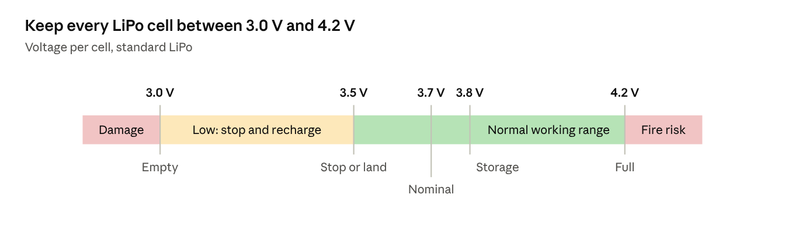<figcaption>Per-cell voltage limits: 4.20 V full, 3.80 V storage, 3.00 V floor</figcaption></figure>

!!! tip "The 30-second sanity check"
    Measure the pack with a cell checker. Divide the total by the number of cells. If the
    answer is not between 3.3 and 4.2, something is wrong: either you have the cell count
    wrong, or the pack is damaged. Stop and ask.

### 2.4 Capacity: mAh, Ah and Wh

- **mAh / Ah** is *charge*, not energy. A 7500 mAh pack delivers 7.5 A for one hour, or
  15 A for half an hour.
- **Wh (watt-hours)** is *energy*, and it is the only number that lets you compare packs
  of different voltages.

```
Wh  =  nominal voltage (V)  x  capacity (Ah)
```

!!! example "Worked example - the two 6S packs in the lab"
    **6S 16000 mAh:**  `22.2 V x 16.0 Ah = 355 Wh`  
    **6S 7500 mAh:**   `22.2 V x 7.5 Ah  = 167 Wh`  
    The 16000 holds **2.1x the energy**, and weighs roughly 2x as much. On a vehicle that
    has to carry it, that extra mass eats much of the extra endurance. Weigh both packs
    on the bench scale and compute Wh/kg before you assume the bigger pack flies longer.

### 2.5 C rating: how fast the pack can be pushed

The **C rate** is a multiplier on capacity. `1C` is the current that would empty the pack
in one hour.

```
1C current (A)  =  capacity (mAh) / 1000
Max continuous current (A)  =  C rating  x  1C current
```

!!! example "Worked example - reading a C rating"
    A pack marked **6S 7500 mAh 25C**:
    `1C = 7500 / 1000 = 7.5 A`  
    `25C x 7.5 A = 187.5 A maximum continuous discharge`  
    A "50C burst" figure on the same label means `50 x 7.5 = 375 A` for a few seconds only.
    **Treat the printed C rating as marketing until proven.** Vendors overstate it routinely.
    **Lab rule: plan to 70% of the printed figure** - here `0.7 x 187.5 = 131 A`. The pack
    runs cooler, lasts longer, and has headroom when a motor stalls.

### 2.6 Reading a pack label

A typical label reads `6S1P 22.2V 7500mAh 25C XT90`. In order:

<figure class="wide">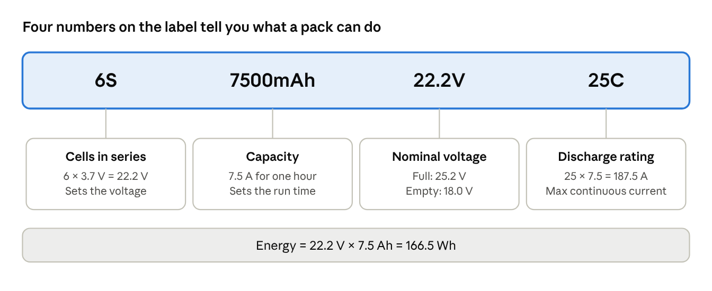<figcaption>Reading a pack label field by field</figcaption></figure>


| Field | Example | Means |
|---|---|---|
| Cell arrangement | `6S1P` | 6 in series, 1 parallel chain -> **set the charger to 6S** |
| Nominal voltage | `22.2V` | `6 x 3.7 V`; the pack is *full* at 25.2 V, not 22.2 V |
| Capacity | `7500mAh` | 7.5 Ah; `1C = 7.5 A`, so charge at 7.5 A or less |
| Discharge C rating | `25C` | up to ~187 A continuous, claimed |
| Connector | `XT90` | the power plug; the small white plug is the **balance lead** |

!!! tip "Two plugs, two jobs"
    Every multi-cell pack has a fat **power connector** (XT60, XT90, EC5, Deans...) and a
    small white **balance connector** (almost always JST-XH). The balance lead gives the
    charger one wire per cell so it can see and equalize each cell individually. **Both
    get plugged in when charging.** See Section 4.3.

### 2.7 State of charge from resting voltage

Measure after the pack has rested a few minutes off load. Under load the voltage sags and
reads low.

| Per cell | 6S pack | Roughly |
|---|---|---|
| 4.20 V | 25.2 V | 100% - full |
| 4.00 V | 24.0 V | ~80% |
| 3.85 V | 23.1 V | ~50% - **storage charge** |
| 3.70 V | 22.2 V | ~30% |
| 3.50 V | 21.0 V | ~15% - land now |
| 3.30 V | 19.8 V | ~5% - **working floor, stop here** |
| 3.00 V | 18.0 V | 0% - damage, not a target |

<figure class="wide">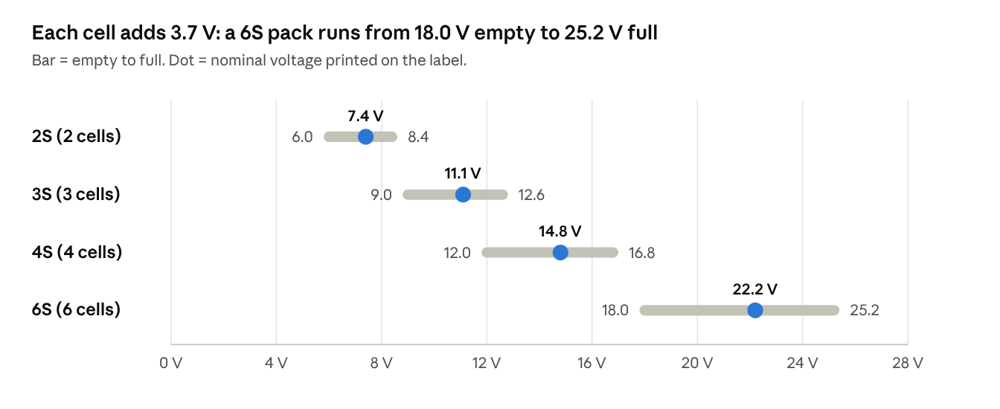<figcaption>Pack voltage across the usable range</figcaption></figure>


---

## 3. Choosing a Battery: Voltage versus Amps

### 3.1 The one equation behind the whole trade-off

```
Power (W)  =  Voltage (V)  x  Current (A)
```

A vehicle needs a certain number of **watts** to do its job. You can deliver those watts
as *low voltage and high current* or as *high voltage and low current*. That choice is
what "3S versus 4S versus 6S" actually is.

### 3.2 Why higher voltage usually wins

Everything expensive about current is **heat**, and heat goes as the *square* of current:

```
Power lost in wires and connectors (W)  =  I^2  x  R
```

!!! example "Worked example - 1000 W delivered at 4S versus 6S"
    A UAV's powertrain needs **1000 W** in the hover. Assume the wiring, connectors and
    solder joints add up to **5 milliohms** of resistance, which is realistic for a small
    airframe.

    **At 4S (14.8 V nominal):**  
    `I = 1000 W / 14.8 V = 67.6 A`  
    `loss = 67.6^2 x 0.005 = 22.9 W wasted as heat`

    **At 6S (22.2 V nominal):**  
    `I = 1000 W / 22.2 V = 45.0 A`  
    `loss = 45.0^2 x 0.005 = 10.1 W wasted as heat`

    Same job, **one third less current and less than half the wiring loss.** That is why
    the industry moved from 4S to 6S on anything that pulls real power.

<figure class="wide">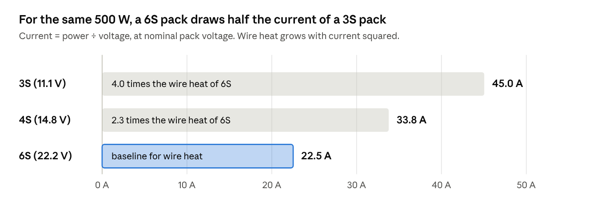<figcaption>Current needed for the same power, by cell count</figcaption></figure>

**What higher voltage buys you**

- Lower current for the same power -> **thinner, lighter wire** and smaller connectors.
- Less `I^2 R` heating in wires, connectors, ESC and the pack itself -> better efficiency,
  longer pack life.
- Less voltage sag under load, so the vehicle behaves the same from full to empty.

**What higher voltage costs you**

- Every component must be rated for it: a 6S pack is 25.2 V fully charged, which will
  destroy an ESC or regulator rated to 4S.
- More cells in series means **more cells to balance** and more ways for one weak cell to
  take the pack down.
- Bigger inrush spark when you plug it in (use an anti-spark connector such as XT90-S).
- More cells means a higher minimum pack size; you cannot build a tiny 6S pack.

!!! tip "Rule of thumb for the lab"
    Pick the **highest cell count every component in the system is rated for**, then size
    capacity for the endurance you need. Check the ESC, the BEC/regulator and the motor
    KV before you change S count on an existing vehicle.

### 3.3 Motor KV changes with cell count

```
no-load RPM  ~=  motor KV  x  pack voltage
```

<figure class="wide">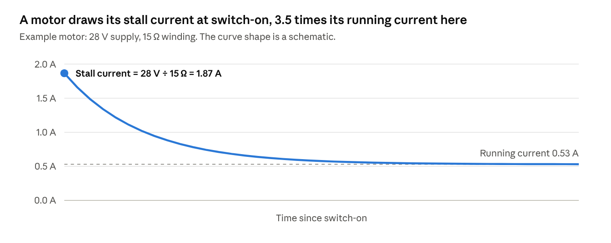<figcaption>Motor inrush current at startup</figcaption></figure>

Swapping a 4S vehicle to 6S without changing the motor raises RPM by about 50%, which
raises current draw sharply and can destroy motors and ESCs. **Changing cell count is a
powertrain redesign, not a battery swap.**

### 3.4 Sizing for endurance

```
usable capacity (Ah)  ~=  0.8  x  rated capacity (Ah)      (never run a pack flat)
run time (min)        =   60  x  usable capacity (Ah) / average current (A)
```

!!! example "Worked example - is the 6S 16000 actually better than the 6S 7500?"
    This is the question behind the lab's plan to retire the 6S 16000 packs. Assume an
    airframe drawing **45 A** at hover with the lighter pack.
    **Weigh your own packs and measure your own current; these figures are an example.**

    | | 6S 7500 | 6S 16000 |
    |---|---|---|
    | Energy | 167 Wh | 355 Wh (2.13x) |
    | Pack mass (example) | ~1.0 kg | ~2.0 kg |
    | All-up craft mass | 3.0 kg | 4.0 kg |
    | Usable capacity | 6.0 Ah | 12.8 Ah |
    | Hover current | 45 A | 69 A |
    | **Run time** | **8.0 min** | **11.1 min** |

    Hover power scales roughly with `mass^1.5` for a fixed rotor size, so the heavier pack
    raises its own current draw: `45 A x (4.0/3.0)^1.5 = 69 A`. The result is that **2.13x
    the energy buys only 1.39x the endurance.** The rest is spent carrying the battery.

    The smaller pack also charges in half the time, costs less to replace, is easier to
    handle, and does less damage if it fails. That is the case for the 7500s.

### 3.5 Checking the pack can supply the current

```
max continuous current (A)  =  C rating  x  capacity (Ah)
```

Compare that against the vehicle's worst-case draw, not its average. If the pack cannot
supply peak current, voltage sags, the vehicle browns out, and the pack gets hot and ages
fast. **Plan to 70% of the printed C rating** (lab margin policy), and if the worst-case
draw lands anywhere near that number, use a bigger pack.

---

## 4. Connectors

### 4.1 The number in the name is not the current rating

!!! warning "The most common and most expensive mistake"
    **XT60 is not a 60 A connector.** The AMASS data for the XT series is roughly
    **15 A continuous for XT30, 30 A continuous for XT60**, with the larger number being a
    short-duration or momentary figure. Published ratings vary widely between vendors and
    often mix continuous with burst. **Always size the connector against continuous draw,
    with margin, and verify the figure on the manufacturer's datasheet for the exact part.**

### 4.2 Power connectors

**Conservative continuous** is the lowest credible published continuous figure, not the
vendor's headline. **Lab limit** is 80% of it, and is the number you design to.

| Connector | Conservative continuous | **Lab limit (80%)** | Wire | Where you see it |
|---|---|---|---|---|
| **Tamiya** (white) | 10 A | **8 A** | 16-18 AWG | Legacy NiMH kit. Obsolete, high resistance - replace it |
| **Deans / T-plug** | 15 A | **12 A** | 12-14 AWG | Older RC cars. Avoid above 3S; hard to solder well |
| **XT30** | 15 A | **12 A** | 18-20 AWG | Micro UAV, small sensors |
| **XT60** (yellow) | 30 A | **24 A** | 14-16 AWG | **Lab default for 3S-4S** |
| **XT90** (blue) | 40 A | **32 A** | 10-12 AWG | **Lab 6S packs.** `XT90-S` adds anti-spark |
| **EC3** | 60 A | **48 A** | 12-14 AWG | Horizon / E-flite ecosystem |
| **EC5** | 120 A | **96 A** | 10-12 AWG | High-current packs, large vehicles |
| **Anderson PP15 / PP30 / PP45** | 15 / 30 / 45 A (UL) | **12 / 24 / 36 A** | 16-20 / 12-16 / 10-14 AWG | Genderless. Bench supplies, ground stations |
| **Bullet 3.5 / 4 / 5.5 mm** | 40 / 60 / 120 A | **32 / 48 / 96 A** | varies | **Unkeyed - no polarity protection.** Motor-to-ESC only |

<div class="plate">
<figure><figcaption>XT60</figcaption></figure>
<figure>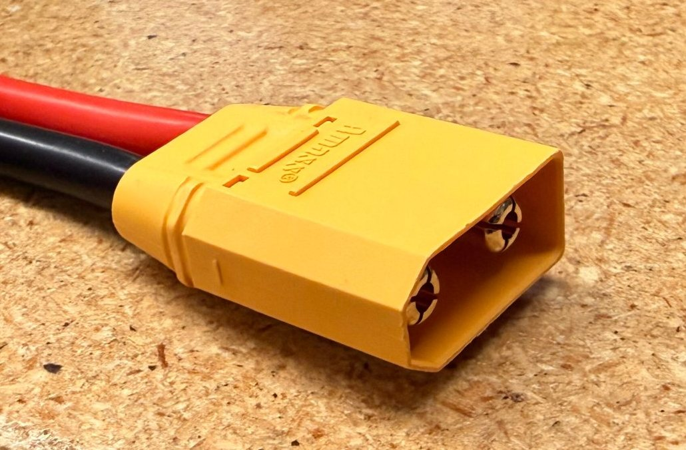<figcaption>XT90 (lab)</figcaption></figure>
<figure><figcaption>XT30</figcaption></figure>
<figure><figcaption>Deans / T-plug</figcaption></figure>
<figure><figcaption>EC5</figcaption></figure>
<figure>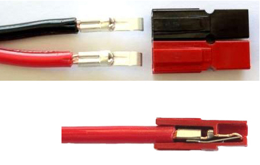<figcaption>Anderson Powerpole</figcaption></figure>
<figure>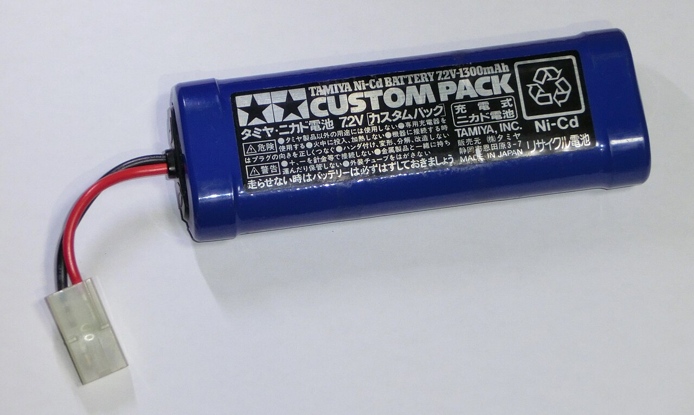<figcaption>Tamiya (legacy)</figcaption></figure>
<figure><figcaption>Bullet 4 mm</figcaption></figure>
</div>

<figure class="wide"><figcaption>XT90 on the lab's 6S packs: two shrouded bullet contacts</figcaption></figure>
<figure class="wide">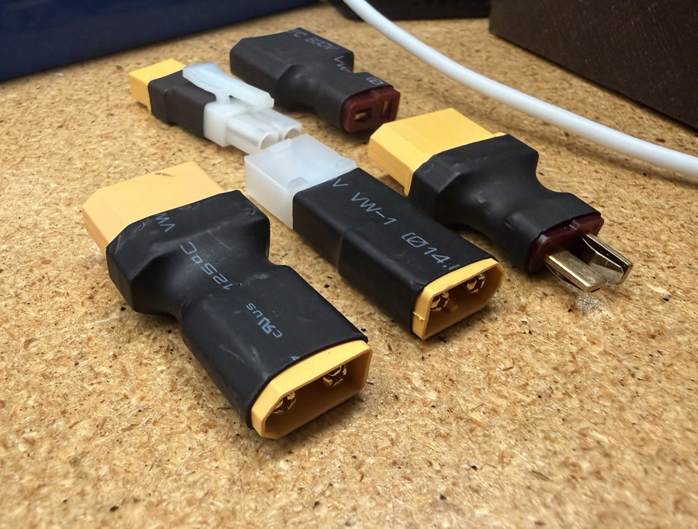<figcaption>The lab's adapter box: XT90, XT60, Deans (red) and Tamiya (white)</figcaption></figure>

!!! warning "One adapter, never two"
    An adapter is only as strong as its weaker side - a Tamiya adapter limits the whole
    path to its 8 A lab limit. Chaining two adds resistance and another chance to plug something
    in backwards.

!!! tip "Anderson Powerpole is the one with a real published rating"
    Anderson publishes UL current ratings per housing: **PP15 = 15 A, PP30 = 30 A,
    PP45 = 45 A**, with matching wire ranges. The ratings carry conditions in the
    datasheet footnotes, so check them for anything near the limit. It is also
    *genderless*, which is why bench supplies and ground stations use it.

### 4.3 Signal, balance and micro-pack connectors

These are the small white plugs. They carry **no propulsion current** - they carry cell
taps and sensor power. The **balance lead on your pack is almost always JST-XH.**

| Connector | Pitch | Rated | **Lab limit (80%)** | Where you see it |
|---|---|---|---|---|
| **JST SH** | 1.0 mm | ~1 A (28 AWG), 50 V | **0.8 A** | Tiny sensors, cameras, GPS modules |
| **JST ZH** | 1.5 mm | ~1 A (26-32 AWG), 50 V | **0.8 A** | Small sensor breakouts |
| **JST PH** | 2.0 mm | 2 A (24 AWG), 100 V | **1.6 A** | Single-cell LiPo packs, dev boards |
| **JST XH** | 2.5 mm | 3 A (22 AWG), 250 V | **2.4 A** | **Balance leads on every multi-cell pack** |
| **JST RCY** ("BEC", red) | 2.5 mm | ~3 A, 250 V | **2.4 A** | Small motors, receiver packs |
| **MX2.0** (Molex 51005/51006) | 2.0 mm | 2.0 A @24 AWG · 1.5 @26 · 1.0 @28, 125 V | **1.6 A** | Micro and whoop-class 1S packs |

<div class="plate">
<figure><figcaption>JST-XH 2.5 mm — balance lead</figcaption></figure>
<figure>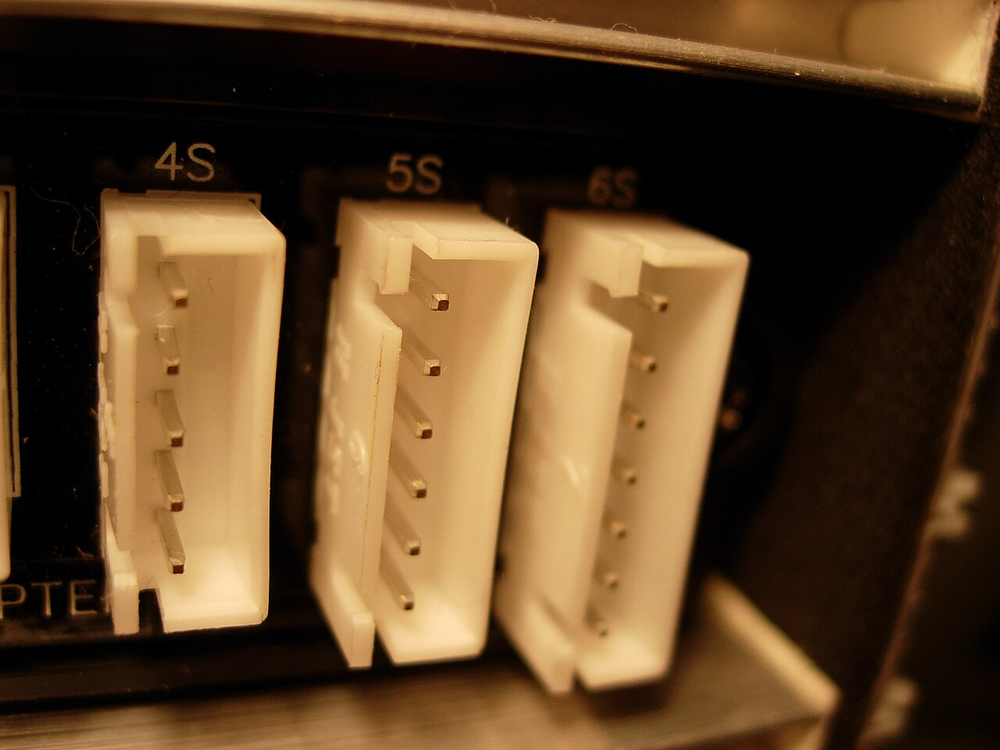<figcaption>JST family</figcaption></figure>
<figure><figcaption>MX2.0 (Molex 51005/51006)</figcaption></figure>
<figure>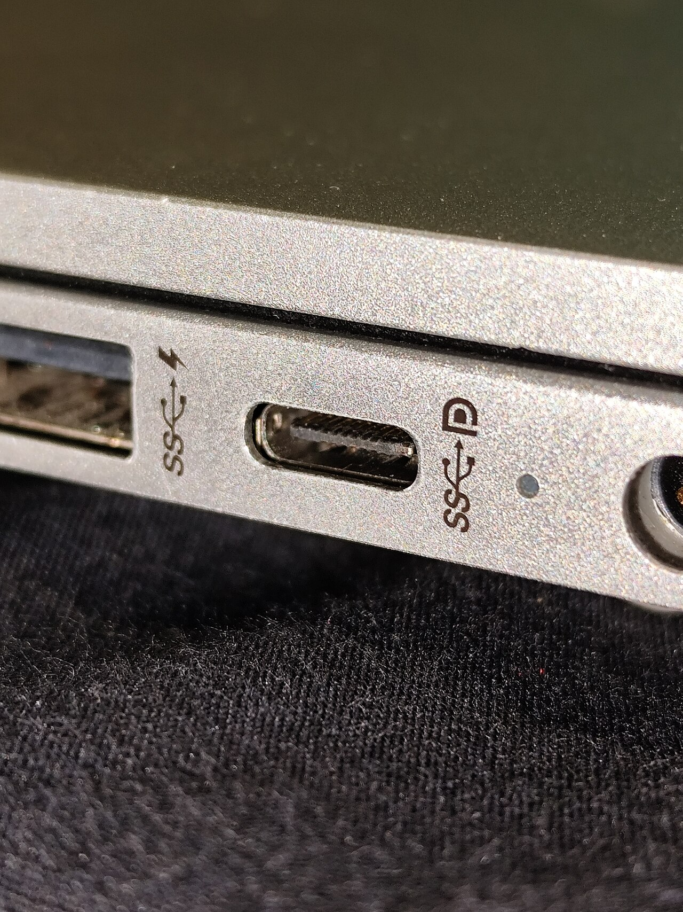<figcaption>USB-C</figcaption></figure>
</div>

!!! warning "Pitch is how you tell them apart"
    "JST 1.0 / 1.5 / 2.0 / 2.5" refers to the **pin pitch in millimetres**, which maps to
    the SH / ZH / PH / XH series. They look alike and **will not mate**. Measure the pitch
    with calipers, or count: an N-pin JST-XH shell is about `N x 2.5 mm` wide.
    A balance plug for an `nS` pack has **n+1 pins** (one per cell boundary plus ground):
    a 6S balance plug has 7 pins.

### 4.4 Picking wire gauge

The connector and the wire have to match. Too thin and the wire gets hot before the
connector does; too thick and it will not fit the barrel.

| Connector | Built for | **Use** (one gauge thicker where it fits) |
|---|---|---|
| XT30 | 18-20 AWG | **18 AWG** |
| XT60, Deans | 14-16 AWG | **14 AWG** |
| XT90, EC5 | 10-12 AWG | **10 AWG** |
| Anderson PP15 / PP30 / PP45 | 16-20 / 12-16 / 10-14 AWG | **16 / 12 / 10 AWG** |

!!! warning "Do not trust a single ampacity chart"
    Published wire current ratings vary by a factor of three because they assume different
    things: free air versus bundled, PVC versus silicone insulation, short versus long runs,
    and different allowed temperature rise. Bundling alone derates capacity by 20-55%.
    **Use the gauge the connector manufacturer specifies**, keep runs short, and if a wire
    or plug is warm after a run, it is undersized.

### 4.5 Soldering and inspection

- Tin the wire and the cup separately, then join. A dull, grainy joint is a cold joint and
  a future fire.
- Heat-shrink every joint. No copper visible anywhere on a pack lead.
- **Solder the female (socket) side of a pack lead first**, and never let the two pack
  leads be bare at the same time - touching them together is a dead short across the pack.
- Inspect before every charge: cracked shells, pushed-back pins, blackened contacts and
  stiff or nicked wire all mean the connector gets replaced before the pack is used.

---

## 5. Chargers

### 5.1 What a charger actually does

A lithium charger runs **CC/CV** - constant current, then constant voltage:

1. **CC phase.** The charger pushes a fixed current you set (for example 7.5 A) and the
   pack voltage climbs. This is most of the charge and most of the time.
2. **CV phase.** Once the pack reaches its target (`4.20 V x cells`), the charger holds
   that voltage and the current tapers off. When current falls to a few percent of the
   set value, the charge ends.

<figure class="wide">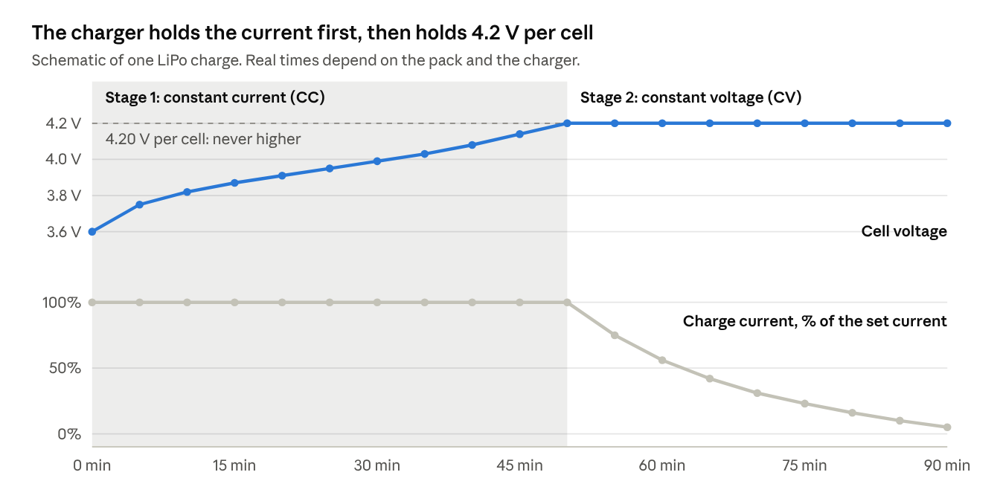<figcaption>CC/CV charge: constant current to 4.20 V per cell, then constant voltage while current tapers</figcaption></figure>

**Balancing** happens alongside this. Cells in a pack drift apart; one reaching 4.25 V
while another sits at 4.10 V is how packs catch fire. Through the balance lead, the
charger measures every cell and bleeds the high ones down until they match - typically
to within **0.01 V**. This is why the balance plug must be connected, and why the last
10% of a charge takes disproportionately long.

!!! danger "Always use Balance Charge for multi-cell packs"
    A plain "Charge" mode watches only the total pack voltage. It cannot see a cell going
    over-voltage. For anything 2S or larger, the mode is **Balance Charge**, every time.

### 5.2 The four settings you must get right

| Setting | How to choose it | What happens if you get it wrong |
|---|---|---|
| **Chemistry** | Read the pack label: LiPo, Li-ion, LiFe, NiMH | Wrong target voltage per cell. LiFe charged as LiPo is over-charged by 0.55 V/cell |
| **Cell count (S)** | Read the pack label. Confirm with a cell checker | **The dangerous one.** 3S charged as 6S drives the pack to 25.2 V - fire |
| **Current (A)** | **0.5C is the lab default** - half the capacity in Ah. 7500 mAh -> 3.75 A. `1C` is the absolute maximum | Too high: heat, swelling, fire. Too low: just slow, which is harmless |
| **Mode** | Balance Charge to use it, Storage to shelve it | See 5.4 |

!!! tip "Say it out loud before you press start"
    *"Six S, LiPo, three point seven five amps, balance charge."* Then check the charger
    screen says the same thing. Most lab incidents are a cell-count typo caught by nobody.

### 5.3 The universal charging procedure

This works on any balance charger, including both chargers on the lab table.

1. **Inspect the pack.** Swollen, punctured, wet, hot or damaged -> stop, quarantine, tell Steve.
2. **Read the label.** Note chemistry, cell count, capacity.
3. **Check resting voltage** with a cell checker. Divide by cell count; every cell should
   be between **3.3** and 4.2 V, and within about 0.1 V of each other.
4. **Put the pack in the LiPo bag or metal bin** on the charging table.
5. **Plug in the balance lead** (the small white JST-XH plug). It only fits one way; do
   not force it.
6. **Plug in the power connector.**
7. **Set chemistry, cell count, current and mode** on the charger. Current = **0.5C**,
   or the charger's power limit if that is lower.
8. **Read the screen back.** The charger should show the cell count it detected - if that
   does not match the pack, **stop** and find out why.
9. **Start, then watch the first minute.** Current should rise to your setting and the
   per-cell voltages should look sane and even.
10. **Stay in the room.** Check periodically. Note the finish time so you can come back.
11. **When it finishes**, unplug the power connector first, then the balance lead.
12. **Log it** if your project requires it, and return the pack to the rack.

!!! warning "If the charger's detected cell count disagrees with the label"
    That means a cell is dead, the balance lead is damaged, or the pack is not what the
    label says. **Do not override it and charge anyway.** Tell a TA.

### 5.4 Modes

| Mode | What it does | When to use it |
|---|---|---|
| **Balance Charge** | CC/CV to 4.20 V/cell while equalizing cells | Every time you charge a 2S or larger pack |
| **Charge** (fast, no balance) | CC/CV on pack voltage only | Single-cell packs only. Avoid otherwise |
| **Storage** | Charges *or* discharges to ~3.80-3.85 V/cell | Any pack sitting more than ~2 days |
| **Discharge** | Drains the pack at a set current | Capacity testing. Not a disposal method |
| **Balance only** | Equalizes cells without charging | Fixing a pack whose cells drifted |

!!! warning "Storage mode is not a disposal step"
    A storage discharge stops around 3.8 V per cell - still most of the pack's energy.
    A pack being thrown out has to be fully discharged through the lab's hazardous waste
    procedure. **Ask Steve; do not improvise.**

### 5.5 Charge rate and how long it will take

```
1C charge current (A)  =  capacity (mAh) / 1000
charge time (h)        ~=  1.15  x  capacity (Ah) / charge current (A)
```

The `1.15` accounts for the CV tail at the end. **The lab default is 0.5C**, which roughly
doubles the charge time and markedly reduces heating and cell wear. `1C` is the ceiling;
above it needs a pack explicitly rated for it and Steve's say-so.

!!! warning "The charger's wattage is usually the real limit"
    A charger has a maximum **power**, not just a maximum current:
    `max current (A) = charger power (W) / pack voltage (V)`  
    A 50 W charger on a 6S pack (25.2 V at the end of charge) can only deliver
    `50 / 25.2 = 2.0 A`, no matter what current you set. That is why a big 6S pack takes  
    all afternoon on a small charger.

!!! example "Worked example - charge times on a 50 W charger"
    **6S 7500 mAh:** 1C would be 7.5 A, but 50 W caps it near 2.0 A.
    `1.15 x 7.5 Ah / 2.0 A = 4.3 hours`  
    **6S 16000 mAh:** `1.15 x 16.0 Ah / 2.0 A = 9.2 hours`  
    The 16000 cannot realistically be turned around in a lab session on this charger.
    This is a practical argument for the smaller packs, separate from the weight argument
    in Section 3.4.

### 5.6 Tenergy TB6B (the large charger on the table)

| Spec | Value |
|---|---|
| Charge power | **50 W** |
| Charge current | **0.1 - 5.0 A** |
| Discharge | 5 W, up to 1.0 A |
| Input | **DC 10.5 - 18.0 V** from the supplied brick (unit label says 11-18 V) |
| LiPo / Li-ion / LiFe | **1 - 6 cells** |
| NiMH / NiCd | 1 - 15 cells |
| Lead-acid (Pb) | 1 - 10 cells |
| Balance tolerance | **±0.01 V** |
| Safety timer | defaults to 120 minutes |

!!! warning "The 50 W limit, not your setting, decides the current"
    `max current = 50 W / full pack voltage`

    | Pack | Full voltage | Most the 50 W limit allows |
    |---|---|---|
    | 3S | 12.6 V | 4.0 A |
    | 4S | 16.8 V | 3.0 A |
    | 6S | 25.2 V | 2.0 A |

    Set the **smaller** of `1C` and this figure. A large pack at low current can also hit
    the 120-minute safety timer before it is full - ask Steve before changing that setting.

<figure class="wide">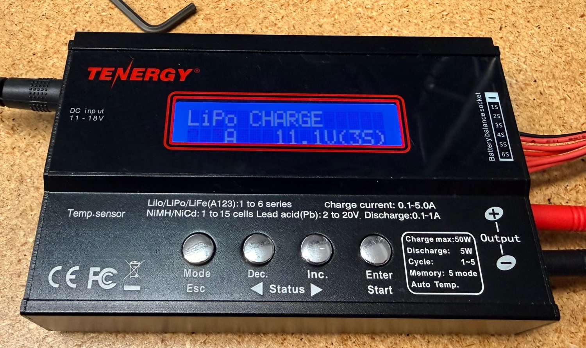<figcaption>Tenergy TB6B: Mode/Esc, Dec., Inc. and Enter/Start</figcaption></figure>
<figure class="wide">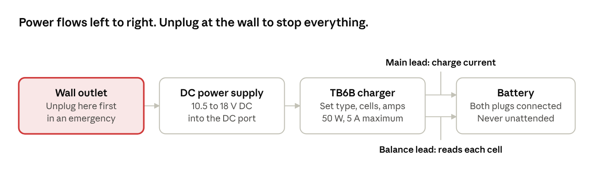<figcaption>TB6B hookup: wall, DC supply, charger, then main lead and balance lead</figcaption></figure>

**Operating it**

1. Connect the DC brick to the wall and to the charger; the name shows for ~2 seconds.
2. Plug the balance board into the balance port and the output lead into the banana
   sockets, red to red and black to black.
3. Connect the pack's main plug, then its balance lead into the balance-board slot
   matching the cell count.
4. Press **Mode/Esc** until the LiPo program shows, then **Enter/Start**.
5. **Dec.** / **Inc.** to select **BALANCE**.
6. **Enter/Start** makes the current blink - set it with **Dec.** / **Inc.** **Enter/Start**
   again, then set voltage and cell count to match the label: 11.1 V for 3S, 14.8 V for 4S,
   22.2 V for 6S.
7. **Hold Enter/Start for 2 seconds.** The screen shows **R** (cells detected) and **S**
   (cells selected). **If R and S differ, press Mode/Esc and stop** - recheck the pack.
8. **Enter/Start** to begin. **Dec.** / **Inc.** cycles the per-cell voltages while it runs.
9. Finish with **Mode/Esc**, unplug the battery, then unplug the charger.

**Other lithium programs:** `CHARGE` (no balancing - do not use on a pack with a balance
lead), `FAST CHG`, `STORAGE`, `DISCHARGE` (1.0 A max).

**Error messages** - the full table is in `battery-cheat-sheets-markdown/markdown/charger-guides.md`.
The ones that mean *stop and fetch a TA*: `CELL LOW VOL`, `CELL HIGH VOL`,
`BATTERY CHECK LOW VOLTAGE`, `BREAK DOWN`, `CONTROL FAILURE`.

!!! danger "Known fault with the lab's TB6B"
    Tenergy balancer boards have a history of failing, and **the unit on the table now will
    not charge 6S packs.** Use it for **2S to 4S only**. Charge 6S packs on the ISDT 608PD
    (Section 5.7). Do not work around a 6S error.

### 5.7 ISDT 608PD - the USB-C charger

**This is the charger for 6S packs**, since the TB6B's 6S balancing has failed.

| Spec | Value |
|---|---|
| Cells | 1 - 6 (LiPo, LiHV, LiFe) |
| Charge current | 0.5 - 10 A |
| Power from USB-C | up to **140 W** |
| Power from DC on its XT60 input | up to 240 W |
| Storage / discharge program | **none** - see below |
| Extra | reads per-cell internal resistance (ESR) |

The lab's unit is labelled `UTA CSE SENIOR DESIGN`, runs from its USB-C port, and carries
an **XT60-to-XT90 adapter** on the output for the 6S packs. Leave that adapter on the
charger so nobody builds an adapter chain.

<figure class="wide">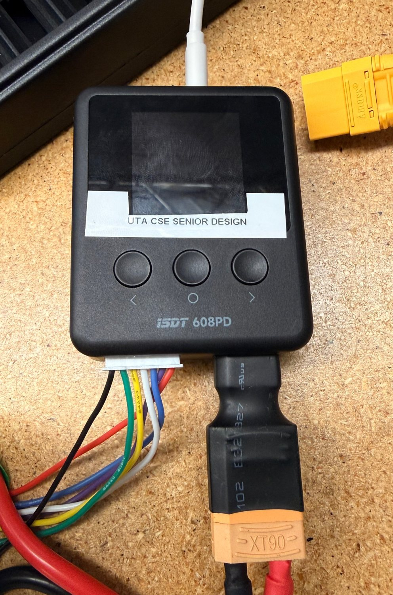<figcaption>ISDT 608PD: USB-C power top, balance lead bottom left, XT90 adapter on the output</figcaption></figure>

#### Why USB-C changes the arithmetic

A USB-C charger draws power through **USB Power Delivery (PD)**, negotiating with the
supply for how much it may take. The charging rules in 5.1-5.5 do not change; the **power
ceiling** does, and with it the charge time.

| Mode | Fixed voltages | Max current | Max power |
|---|---|---|---|
| USB-PD SPR | 5 V, 9 V, 15 V, 20 V | 3 A (5 A with an e-marked cable) | 60 W at 20 V/3 A; **100 W at 20 V/5 A** |
| USB-PD EPR (PD 3.1) | adds 28 V, 36 V, 48 V | 5 A | 140 W / 180 W / **240 W** |

!!! danger "The adapter you plug into sets your charge rate"
    `max current = adapter watts / full pack voltage`

    | USB-C adapter | into 6S (25.2 V) | into 4S (16.8 V) | into 3S (12.6 V) |
    |---|---|---|---|
    | 65 W | 2.6 A | 3.9 A | 5.2 A |
    | 100 W | 4.0 A | 6.0 A | 7.9 A |
    | 140 W | 5.6 A | 8.3 A | 10 A (charger limit) |

    Figures ignore conversion losses, so expect slightly less. **Read the wattage printed
    on the adapter before you set a current.** A 15 W phone brick on a 6S pack gives
    `15 / 25.2 = 0.6 A` - over 14 hours for a 7500 mAh pack.  
    **Anything above 100 W also needs an EPR-marked cable**; an ordinary USB-C cable caps
    the link at 100 W however capable both ends are. A charger that restarts or shows an
    input error is nearly always being starved by the supply or the cable, not broken.

#### Operating it

Buttons are **left**, **centre** and **right**, under the screen.

1. Inspect the pack. Puffy, damaged or warm -> stop, hand it to Steve or a TA.
2. **Power the charger from the USB-C adapter first** and let it boot and finish
   negotiating.
3. Connect the pack's main plug to the output (through the XT90 adapter for 6S), then the
   balance lead.
4. **centre** opens the profile list; **left** / **right** pick a profile.
5. **Hold centre** to edit. **left** / **right** change a value, **centre** moves to the
   next, **hold centre** to leave edit mode.
6. Check chemistry, cell count and current against the pack label. Current = `1C` or less,
   and no more than the adapter table allows.
7. **centre** to start. Stay with the charger.
8. **left** / **right** show per-cell voltage and internal resistance while it runs.
9. Double-press **centre** to stop early. When done, unplug the pack, then the charger.

**Check a pack without charging:** plug in **only the balance lead**; the screen shows each
cell's voltage.

!!! warning "Two gaps on this charger"
    1. **No storage or discharge program.** Use the TB6B's `STORAGE` program for 2S-4S
       packs. For 6S, ask Steve how the lab brings packs to storage voltage.
    2. **NOT VERIFIED ON THIS UNIT.** The button sequence above comes from a published
       review of the model, not from a test on the charger on the table, and its error
       codes are undocumented. **Walk it through once at the table before trusting it.**
       Tracked as **T1 in `todo.md`.**

!!! tip "Check the profile every single time"
    The charger stores five profiles and keeps whatever the last user left in them.

### 5.8 NOCO Genius 2 - lead-acid only

A 2 A automatic charger for 6 V and 12 V lead-acid, and for 12 V lithium packs that have a
built-in BMS. It is for the APC lead-acid battery.

<figure class="wide">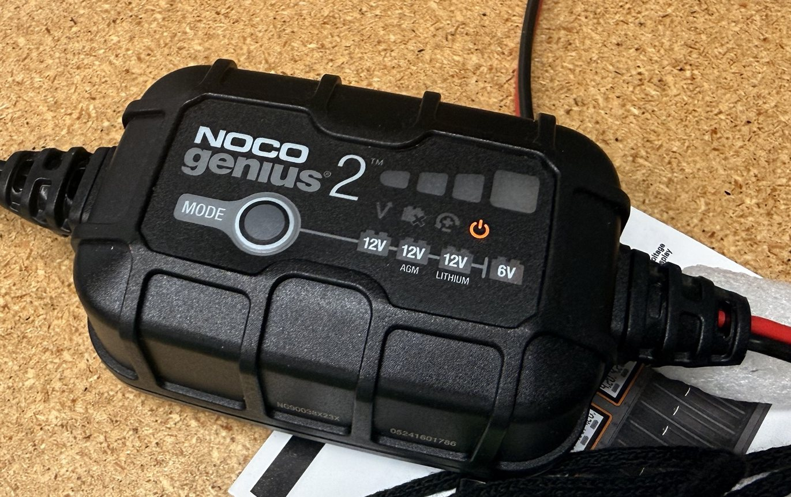<figcaption>NOCO Genius 2: MODE button and the 12V / 12V AGM / 12V LITHIUM / 6V LEDs</figcaption></figure>

!!! danger "Never put a LiPo pack on the NOCO"
    Lab LiPo packs have no BMS and the NOCO cannot balance cells.

1. Red to positive, black to negative, then plug the charger into the wall.
2. Press **MODE** until the LED matches the battery: `12V`, `12V AGM`, `12V LITHIUM` or `6V`.
3. It runs and stops on its own.

---

## 6. Troubleshooting

| Symptom | Likely cause | What to do |
|---|---|---|
| Charger shows the wrong cell count | Dead cell, damaged balance lead, wrong pack label | **Stop.** Do not override. Tell a TA |
| `CONNECTION ERROR` / `BALANCE ERROR` | Balance plug not seated, bent pin, broken lead | Unplug everything, inspect the plug, reseat. Still failing -> quarantine the pack |
| `INPUT VOLTAGE LOW` | Power brick undersized or failing; USB-PD supply too weak | Use the correct brick, or a higher-wattage PD supply and a better cable |
| Charge current never reaches the set value | Charger's wattage limit (Section 5.5), or a weak USB supply | Expected behaviour. Allow more time, or use a bigger supply |
| One cell reads far below the others | Cell is failing | Quarantine the pack, tell Steve. Do not keep charging it |
| Pack gets warm while charging | Normal if mildly warm; **not normal if hot** | Hot -> stop immediately, disconnect, leave it in the bin, call for help |
| Pack puffs during a charge | Over-charge, over-current, or an end-of-life cell | **Stop immediately.** Quarantine. This pack is finished |
| Charge finishes in minutes | Pack was already nearly full, or the charger is on the wrong cell count | Re-check settings and resting voltage |
| Connector or wire warm after a run | Undersized wire or connector, or a cold solder joint | Rebuild the joint, go up a gauge, check the rating in Section 4 |

---

## 7. Glossary

| Term | Meaning |
|---|---|
| **1C** | The current that empties (or fills) a pack in one hour. Numerically the capacity in Ah |
| **AWG** | American Wire Gauge. **Smaller number = thicker wire** |
| **Balance lead** | The small multi-pin plug giving the charger access to each cell. `n+1` pins for an `nS` pack |
| **BEC** | Battery Eliminator Circuit; the regulator that makes 5 V for electronics from pack voltage |
| **CC/CV** | Constant current, then constant voltage. How lithium cells are charged |
| **C rating** | Multiplier on capacity giving maximum safe current |
| **ESC** | Electronic Speed Controller. Must be rated for the pack's **full-charge** voltage |
| **EPR / SPR** | Extended / Standard Power Range: the USB-PD tiers above and below 100 W |
| **LiPo bag** | Fire-resistant container for charging and storing packs |
| **Nominal voltage** | The pack's "name" voltage, 3.7 V per LiPo cell. Not its full voltage |
| **nS / nP** | n cells in series (voltage) / in parallel (capacity) |
| **Pitch** | Spacing between connector pin centres, in mm. How JST series are told apart |
| **Storage charge** | ~3.80-3.85 V per cell, the voltage a pack should sit at on the shelf |
| **Thermal runaway** | Self-sustaining overheating of a lithium cell. The failure mode behind every battery fire |
| **Wh** | Watt-hours. Energy. The only fair way to compare packs of different voltages |

---

## 8. Sources and How to Verify

Every number in this document is one of three kinds, and they are not equally solid:

- **Manufacturer data** (Anderson UL ratings, JST and Molex datasheet currents, USB-PD
  spec tiers, Tenergy's own manual). Treat as reliable; cite the datasheet.
- **Industry consensus** (LiPo cell voltages, 1C charging, storage voltage). Consistent
  across every source, and matches what the chargers do. Reliable in practice.
- **Vendor and community figures** (connector current ratings, wire ampacity). These
  **conflict between sources by a factor of two or more** and often mix continuous with
  burst. Used here with ranges and caveats. Verify against the exact part's datasheet
  before designing around them.

**Primary sources**

- Tenergy TB6B manual (PDF) - <https://cdn.robotshop.com/media/t/ten/rb-ten-48/pdf/tenergy-tb6b-multi-balance-charger-nimh-nicdlipoli-fe--power-supply-manual.pdf>
- Tenergy TB6B product page - <https://power.tenergy.com/tenergy-tb6b-multifunctional-balance-charger-for-nimh-nicd-li-po-li-fe-battery-packs-power-supply>
- Anderson Power Products PP15/45 datasheet - <https://www.wagneronline.com.au/attachments/Datasheets/Anderson-PP.pdf>
- Anderson Power Products on amperage ratings - <https://www.andersonpower.com/us/en/about-us/blog/2-17-amperage-ratings.html>
- JST XH series datasheet (Digi-Key mirror) - <https://www.digikey.be/en/resources/datasheets/jst/xh-connector>
- JST series selection guide (SH / ZH / PH / XH pitch and current) - <https://grobotronics.com/images/companies/1/datasheets/jst%20core%20selection.pdf>
- Molex 51005/51006 2.0 mm datasheet (current by wire gauge) - <https://www.electrokit.com/upload/product/41015/41015371/51005.pdf>
- USB-PD EPR and SPR tiers (Diodes Inc.) - <https://diodes.com/design/support/perspective/usb-pd-epr-and-spr-unraveling-the-differences>
- USB-PD 3.1 240 W announcement (USB-IF via Business Wire) - <https://www.businesswire.com/news/home/20210526006131/en>
- XT connector ratings - the number is not the rating - <https://www.unmannedtechshop.co.uk/blogs/knowledge-base/fpv-drone-battery-connector-guide-xt30-xt60-xt90-ratings>
- Holybro connector and wire rating notes (XT60 30 A continuous / 60 A instantaneous) - <https://docs.holybro.com/power-module-and-pdb/power-module/connector-and-wire-rating>
- University of Delaware EHS, lithium battery safety - <https://www1.udel.edu/ehs/research/downloads/csm/91.pdf>
- Rutgers REHS lithium battery guidance - <https://construction.rutgers.edu/rehs/lithium-battery-guidance>
- LiPo voltage and charging fundamentals - <https://www.grepow.com/blog/what-is-the-voltage-of-a-lipo-battery.html>
- Silicone wire current capacity, with its own caveats - <https://sparks.gogo.co.nz/silicone-wire-current-capacity.html>
- Oscar Liang, wires and connectors for drones - <https://oscarliang.com/wires-connectors>

**Open items**

Tracked in **`todo.md`** - six items, including the two that matter most: the ISDT 608PD
procedure is **not yet verified on the lab's own unit** (T1), and the lab currently has
**no documented way to storage-charge a 6S pack** (T2).
